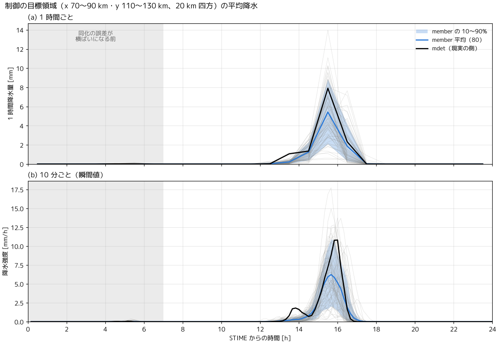
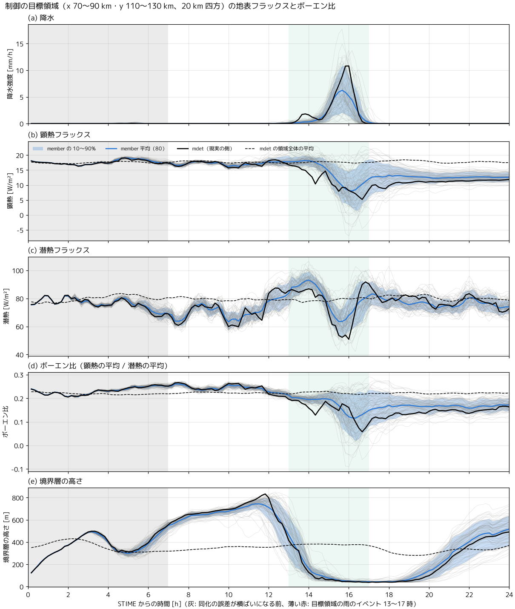
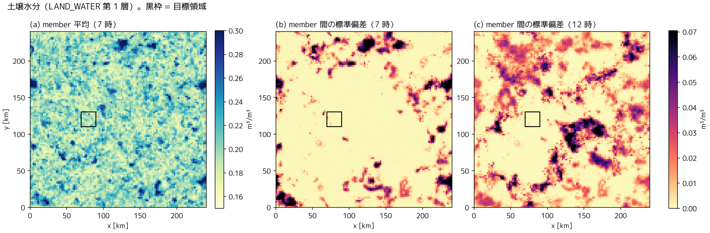
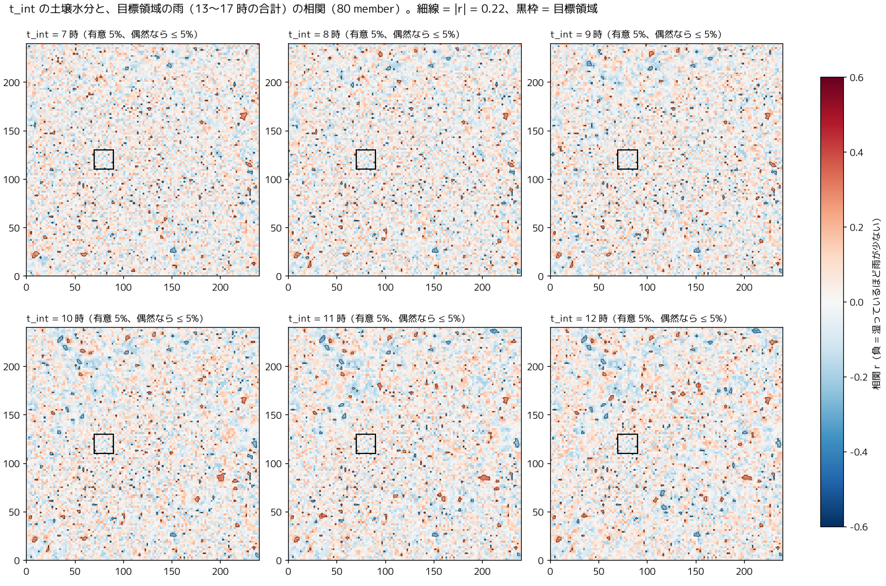
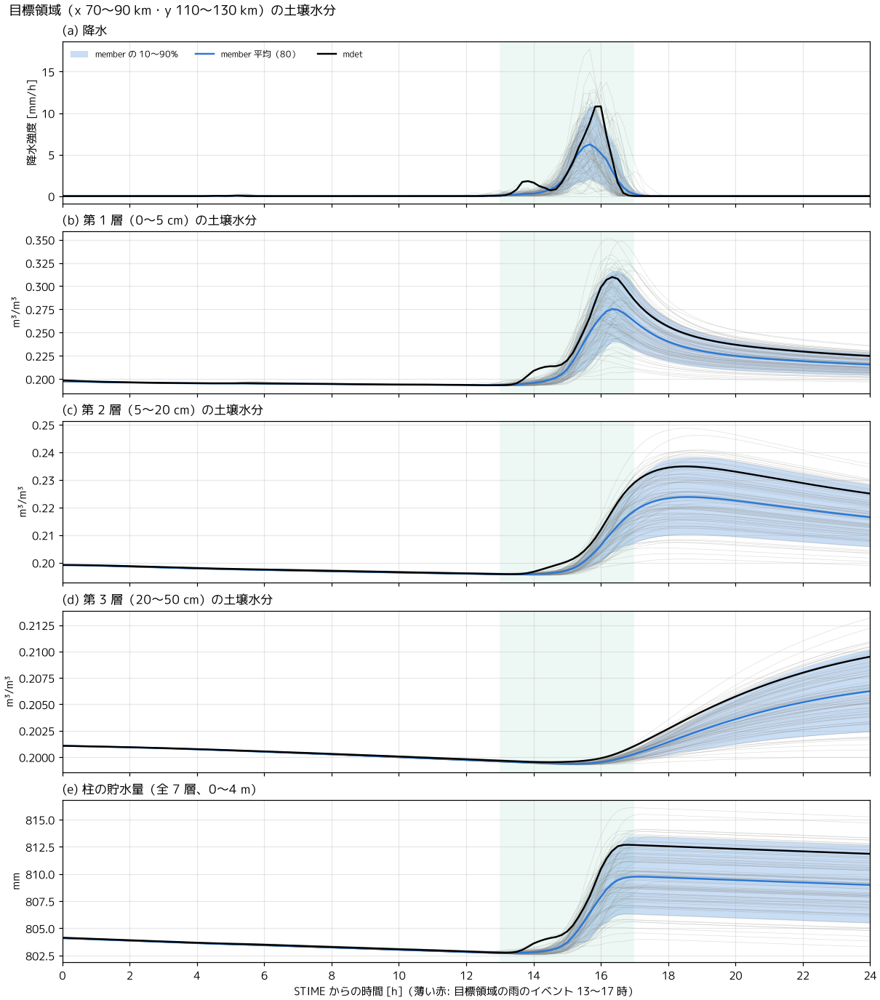
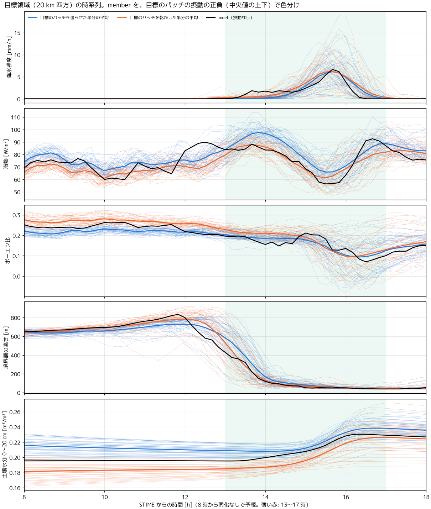
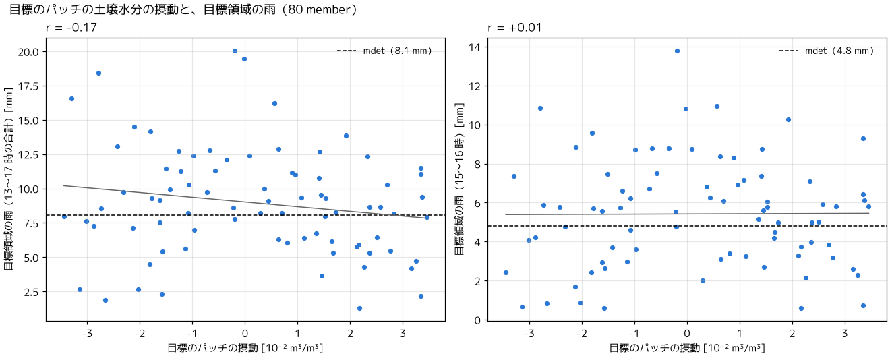
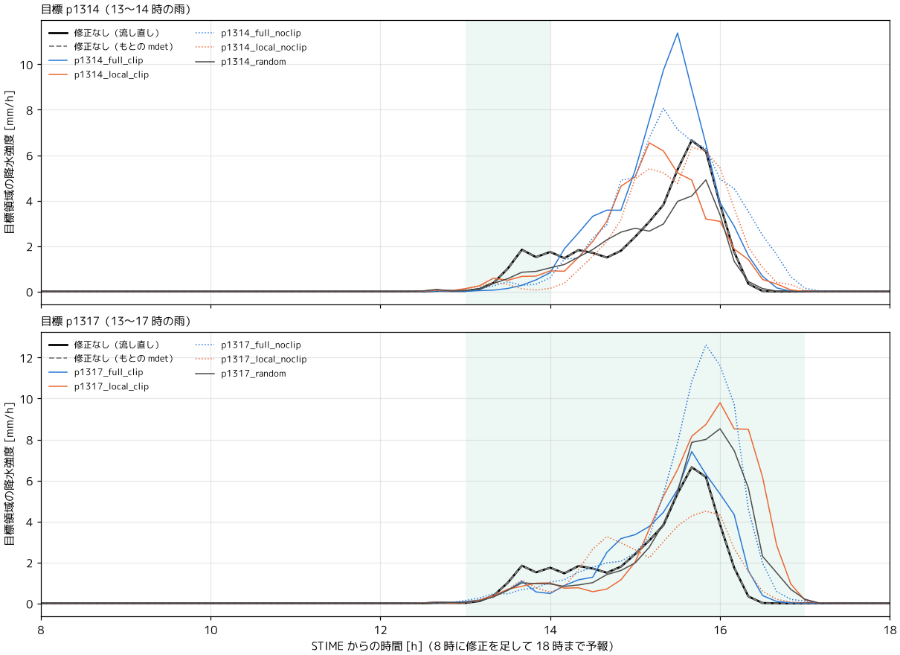

# 制御の実験の記録（2026-11-02〜）

土壌水分による対流性降雨の EnKC 制御の実験の記録。
最初に**制御の方針（基準の設定）**を書き、そのあとの各実験は「基準から何を変えたか」を先に書く。
決定事項の正本は計画書（`docs/setup/20260923_experiment_plan.md` の 5 節。もとの 9-1）。ここには、その要約と実験の結果を残す。

計算の結果の置き場所（`/work/gv42/v42013/20260923_enkc_convection/` の `phase9_patch_t08/`・`phase9_control_t08/`）は、
フォルダの整理（2026-11-06）の前の名前のまま。

---

## 1. 制御の方針

### 1.1 系と役割（準備の段階で決まったもの）

| 項目 | 内容 |
| --- | --- |
| モデル | SCALE-RM、水平 2 km、120 × 120 格子（240 km 四方）、二重周期、全面陸、バケツ型の土壌（7 層：上から 5・15・30・50・100・100・100 cm）、日射は固定（日変化なし） |
| 真値（現実） | mdet。観測は mdet の予報にノイズを足したもの。**制御は mdet に介入する** |
| アンサンブル | 準備の段階の 24 時間の cycle（80 member、毎時 LETKF で同化、制御なし。`result_m80`、ジョブ 10083341） |
| 同化 | LETKF は大気の 11 変数だけ。**土壌水分は LETKF で更新しない**（2026-10-14、指導教員）。inflation（INFL_MUL 1.45、RTPS 0.8）も大気だけ |

### 1.2 基準の設定（最初の叩き台、2026-11-02）

今週の目標は、完璧な結果ではなく「対流性降雨でも EnKC で制御ができる」ことを示す叩き台を作ること。
下の各実験は、この設定を基準にして一部を変えたもの。

| 項目 | 基準の設定 | 決めた人・日 |
| --- | --- | --- |
| 目標領域 | x 70〜90 km・y 110〜130 km の 20 km 四方（格子 i 35〜44・j 55〜64、0 始まり、10 × 10 格子）。mdet で 12〜24 時の積算がいちばん多い 20 km 格子。80 member 中 72 member で領域の上位 5% に入る | ユーザー |
| 粗い格子の大きさ | 20 km。16 km 未満は同化で誤差が減らない、40 km では領域の最大とほぼ同じになる | ユーザー |
| 目標にする量 Y | 目標領域で平均した降水 P の、**13〜17 時の合計**（20 km 格子の和 Σ P は、この平均 × 100） | ユーザー |
| 目標値 y* | 8 mm（member の中央値付近） | ユーザー |
| 目標の誤差 σ_R | σ_R = σ_Y（80 member の Y の標準偏差）。差の半分を詰めにいく | ユーザー |
| 修正する変数 | 土壌水分。**増やす向きだけ**。水蒸気など大気の量は使わない（土壌水分による制御であることが研究の意義） | 2026-10-03・11-04、ユーザー |
| 修正してよい範囲 | 領域全体 | ユーザー |
| 修正量の式 | Δθ = cov(θ, Y) / (var(Y) + σ_R²) · (y* − Ȳ)。cov・var・Ȳ は 80 member を標本として計算する | — |
| 感度を見積もるアンサンブル | 介入の時刻 t_int から、同化なしで予報し直した 80 member | ユーザー |
| 介入の時刻・回数 | 時刻はある程度うまくいくように決めてよい。回数は 1 回に限らない | 指導教員・ユーザー |
| 評価 | 目標領域の 20 km 格子の和だけを見る（点の最大・強雨の面積は見ない） | ユーザー |
| 実装 | 1 回の介入は、Python で修正量を計算し、mdet の restart の `LAND_WATER` に足して予報し直す（LETKC は今、最下層の水蒸気を減らす向きに固定されていて、土壌水分を修正できない） | Claude の案で実施 |

### 1.3 方針の変更（2026-11-04、指導教員とのミーティング）

最初の叩き台の結果（2.・3.8）を受けて、次のように変えた。

| 項目 | 基準の設定 | 変更後 |
| --- | --- | --- |
| 目標の形 | 13〜17 時の合計（固定した時間帯の積算） | 介入すると、その後の予報そのものが変わるので、固定した時間帯は目標にしない。介入のたびに「その時点からホライズン T_c までの予報」を目標にし、**逐次的に繰り返す（MPC）**（指導教員） |
| ホライズン T_c | 8 時から 13〜17 時まで（5〜9 時間） | **まず 1 時間**。うまくいかなければ 2 時間・3 時間と伸ばす（指導教員） |
| 目標領域 | 上の 20 km 格子 | 変えない（ユーザー） |
| σ_R | σ_Y | 変えない（ユーザー） |
| 修正する変数 | 土壌水分だけ | 変えない（ユーザー） |

### 1.4 まだ決めていないこと

- 逐次の制御での目標値 y*（例: 次の予報の 80% にする。ユーザーの案）
- 土壌水分のばらつきの保ち方（cycle の間に土壌水分だけの inflation を入れるか、摂動を入れ直すか）。
  あわせて、8 時の土壌水分のアンサンブル平均と mdet の差（実際の誤差）が、ばらつき（約 0.001）と同じくらいかの確認
- 逐次の制御の実装（LETKC に土壌水分を加えるか、Python で cycle の間に修正を入れるか）
- 介入のシグナル（ボーエン比・境界層の高さで、それぞれ制御のシミュレーションを行うことは 2026-11-02 に決めたが、まだ行っていない）

---

## 2. わかったことの一覧

| 節 | 基準から変えたもの | わかったこと |
| --- | --- | --- |
| 3.1 | なし（目標の雨の確認） | 目標領域の雨は 13〜17 時の 1 回のイベント。時刻はどの member でもそろい、違うのは強さ |
| 3.2 | 見る量：地表フラックス・ボーエン比・境界層の高さ | 雨の前、目標領域は周りより乾いた側で、境界層が厚い。ただし member でほとんどばらつかない |
| 3.3 | 感度のアンサンブル：準備の段階の cycle をそのまま使う。介入の時刻：0〜12 時 | 土壌水分のばらつきは約 0.001 しかなく、格子ごとの相関は雑音。20 km で平均すると −0.2〜−0.3 の弱い相関 |
| 3.4 | なし（土壌水分の動きの確認） | 初期の摂動は下の層へ移って薄まり、8〜9 時が最小。10 時以降のばらつきは雨の違いで育つ |
| 3.5 | 感度のアンサンブル：8 時に 20 km のパッチごとに摂動（標準偏差 0.02）を入れ直す | 土壌水分 → ボーエン比はほぼ決定的。雨は降り始め（13〜14 時）だけが動き、ピーク・合計は動かない |
| 3.6 | 見る量：LCL・LCL の不足分 | どれも土壌水分の写しで、降り始めを土壌水分以上には説明しない。効くのは周りとの差らしい |
| 3.7 | 見る量：格子ごとのボーエン比 | どこのボーエン比も、目標領域の雨を説明しない |
| 3.8 | 実際に mdet に介入する（8 時に 1 回）。表し方 full / local、湿らせるだけ / 切らない、目標 13〜14 時も | 修正量は 0.0004〜0.006 と小さく、雨の変化はカオスの揺れに埋もれた。ランダムな場所に足しても同じくらい変わる |

まとめると、基準の設定（8 時に 1 回、目標は 13〜17 時の合計）では、EnKC による雨の制御は検出できなかった。原因は 2 つ。
member の雨の違いは土壌水分ではなく大気の違いとカオスから来ていて、cov が小さい。
また、どんな小さな修正でも 5 時間のうちにカオスで育ち、雨は別の道に乗り換わる。
これを受けて、方針を逐次の制御に変えた（1.3）。

---

## 3. 各実験

### 3.1 目標領域の雨の時間変化（2026-11-02）

**変えたもの**: なし。基準の設定の目標と介入の時刻を決めるための材料。
制御の効果を EnKC で測るには、次の 3 つが要る（ユーザー）:
同化の誤差が横ばいになった後であること、mdet で目標領域に雨があること、土壌水分が雨に効くまでの時間をとれること。

#### 方法

- 目標領域: 1.2 のとおり。4 プロセス分のファイル（`history.pe000063`・`64`・`75`・`76`）にまたがる
- データ: 準備の段階の 24 時間の cycle（80 member、`result_m80`、ジョブ 10083341、制御なし）。各 cycle の 1 時間予報の history の地上降水強度 `PREC`（10 分ごと）を目標領域で平均した
  - 1 時間降水量は 600〜3600 s の 6 時刻 × 600 s の和（`plot_member_prec.py` と同じ近似）
  - 目標領域だけを読む方法が、全格子を読んで切り出した値と一致することを、mdet の 0・1・12 時の cycle で確認した
- スクリプト: `analysis/control/20261102_target/plot_target_prec.py`（ジョブ `analysis/control/20261102_target/plot_target_prec_job.sh`、Aquarius、ジョブ 10118605、約 3 分）
- 出力: `20261102_target_prec/target_prec.png`・`target_prec.out`（表）・`target_prec.npz`（10 分ごとの値）

#### 結果

| 時間 [h] | mdet [mm] | member 平均 | 10% | 50% | 90% | 最大 | mdet の順位（多い順 / 80） |
| --- | --- | --- | --- | --- | --- | --- | --- |
| 12–13 | 0.02 | 0.04 | 0.00 | 0.02 | 0.09 | 0.30 | 35 |
| 13–14 | 1.07 | 0.22 | 0.04 | 0.18 | 0.43 | 1.23 | 2 |
| 14–15 | 1.35 | 1.25 | 0.41 | 1.15 | 2.25 | 3.08 | 30 |
| 15–16 | **7.90** | 5.42 | 2.11 | 5.26 | 8.84 | 13.97 | 17 |
| 16–17 | 2.32 | 1.86 | 0.32 | 1.35 | 4.10 | 7.65 | 24 |
| 17–18 | 0.00 | 0.03 | 0.00 | 0.00 | 0.05 | 0.90 | 69 |

上の 6 時間以外は、どの member もほぼ 0（4〜6 時に 0.02 mm 程度の弱い雨があるだけ）。
24 時間の合計は mdet 12.70 mm、member 平均 8.85 mm（最小 1.80・最大 19.00 mm）。

- 目標領域の雨は、**13〜17 時の 1 回のイベント**。ピークは 15〜16 時
- **イベントの時刻は、ほぼすべての member でそろっている**。member で違うのは強さ（15〜16 時の 1 時間降水量で 10〜90% が 2.1〜8.8 mm）
- **mdet は強い側**: 15〜16 時は 7.90 mm で、80 member 中 17 位。10 分ごとのピークは約 11 mm/h（15.8 時ごろ）。13〜14 時には、member にはほとんどない早い雨（1.07 mm、2 位）がある
- 3 つの条件との関係: 雨は同化の誤差が横ばいになる 7 時より後にある / mdet に抑える対象の雨がある / 降り始め（12.5〜13 時）まで、7 時から 5〜6 時間の余裕がある
- 今回のイベントは、合計の約 6 割がピークの 1 時間に集中している（mdet 7.9 / 12.7 mm）

### 3.2 目標領域の地表フラックス・ボーエン比・境界層の高さ（2026-11-02）

**変えたもの**: 見る量を、雨から地表フラックス・ボーエン比・境界層の高さに。
介入のシグナルの候補として、ボーエン比（顕熱 / 潜熱）が雨の前に動くかを見る（Liu et al. 2022 の 2 章、Fig. 2・4 から）。

#### 方法

- 目標領域・データは 3.1 と同じ。history の `SHFLX`・`LHFLX`・`PBLH`・`PREC`（10 分ごとの瞬間値）を目標領域で平均した
- ボーエン比は、顕熱の平均 / 潜熱の平均（格子ごとの比の平均ではない）。比べるため、mdet の領域全体の平均（全 144 ファイル）も出した
- スクリプト: `analysis/control/20261102_target/plot_target_bowen.py`（ジョブ `analysis/control/20261102_target/plot_target_bowen_job.sh`、Aquarius、ジョブ 10121125、約 11 分）
- 出力: `20261102_target_bowen/target_bowen.png`・`target_bowen.out`（1 時間平均の表）・`target_bowen.npz`

#### 結果

| 時間 [h] | 降水 mdet [mm] | 潜熱 mdet / 領域 [W/m²] | ボーエン比 mdet / member 平均 / 領域 | 境界層の高さ mdet / 領域 [m] |
| --- | --- | --- | --- | --- |
| 5–6 | 0.02 | 74.4 / 81.8 | 0.247 / 0.248 / 0.216 | 350 / 310 |
| 7–8 | 0.00 | 64.2 / 80.9 | 0.260 / 0.256 / 0.222 | 617 / 324 |
| 9–10 | 0.00 | 69.7 / 78.7 | 0.244 / 0.244 / 0.224 | 686 / 351 |
| 11–12 | 0.00 | 71.1 / 79.1 | 0.240 / 0.238 / 0.223 | 801 / 354 |
| 12–13 | 0.02 | 85.7 / 78.9 | 0.208 / 0.220 / 0.220 | 570 / 363 |
| 15–16 | 7.90 | 55.4 / 79.5 | 0.163 / 0.158 / 0.222 | 51 / 377 |

（全時刻は `target_bowen.out`。顕熱は雨の前は目標領域も領域全体も約 17〜18 W/m² で、ほぼ同じ）

- **雨の前（5〜12 時）、目標領域のボーエン比は領域全体より高い**（0.24〜0.26 に対して約 0.22。1〜2 割高い）。
  顕熱は領域全体とほぼ同じで、違うのは潜熱（目標領域が 1〜2 割少ない）。目標領域は、まわりより蒸発の少ない（乾いた側の）場所
- **境界層が雨の前に厚くなる**: 目標領域の境界層の高さは、5 時の約 300 m から 12 時の約 800 m まで育つ（領域全体は 300〜400 m でほぼ一定）。
  雨が始まる 12〜13 時に崩れ、雨の間と後は 50 m 前後まで下がる（雨で地表が冷えるため）
- 雨の前の顕熱・潜熱・ボーエン比・境界層の高さは、**80 member でほとんどばらつかない**（mdet とも重なる）。ばらつきが出るのは雨が始まってから
- 雨の後（17 時以降）は、雨で地表が湿り、ボーエン比が約 0.15 に下がったまま（潜熱は戻るが、顕熱が約 12 W/m² に下がる）
- 地表フラックスは全体に小さい（顕熱 17 W/m²・潜熱 80 W/m² 程度）。日射が一定（`fixeddate`）の設定のため

#### 読み取り（解釈は相談中）

- 「乾いた側の場所 → ボーエン比が高い → 境界層が厚くなる → 対流」は、論文 Fig. 4 の負のフィードバックの経路と同じ向きに見える。
  負のフィードバックなら、土壌を湿らせる（増やす向きの）介入で雨を抑えられる可能性がある。ただし、これは 1 つの実験の中での並びで、因果は確かめていない
- シグナルの候補: ボーエン比の領域平均からのずれ（5〜6 時から出る）、境界層の高さ（7 時以降に領域平均の約 2 倍）
- 懸念: 雨の前の member のばらつきが非常に小さい。共分散で「どこを湿らせればよいか」を見積もるには、土壌水分とフラックスのばらつきが要る

### 3.3 準備の段階のアンサンブルでの、土壌水分と雨の相関（2026-11-02・03）

**変えたもの**: 感度のアンサンブルを、t_int から予報し直さず、準備の段階の cycle の結果（途中で 1 時間ごとに同化が入る）をそのまま使う（下見）。
介入の時刻 t_int は 7〜12 時（11-02）、のちに 0〜12 時のすべての時刻と 3 種類の土壌水分に広げた（11-03）。

#### 方法

- θ（以下 u）: 時刻 t の解析の restart（0 時は初期値）の `LAND_WATER`。土壌水分は LETKF で更新しないので第一推定と同じ。
  11-02 は第 1 層（0〜5 cm）、11-03 は第 1 層・第 2 層（5〜20 cm）・0〜20 cm の平均（厚さで重み付け）
- Y: 目標領域の平均降水（3.1 の `target_prec.npz` から）。13〜17 時の合計（total）と、15〜16 時の 1 時間降水量（peak）
- u と Y の相関の地図。80 member で偶然と区別できるのは |r| > 0.22（両側 5%）。
  有意な格子の割合を、Y を並べ替えた 500 回（偶然だけの場合）の割合の 95% 点と比べた。あわせて、目標領域で平均した u と Y の相関
- スクリプト: `analysis/control/20261102_soil_cov/check_soil_cov.py`（ジョブ `check_soil_cov_job.sh`、Aquarius、ジョブ 10121256、約 8 分）、
  `analysis/control/20261102_soil_cov/check_soil_cov_all.py`（ジョブ `check_soil_cov_all_job.sh`、Aquarius、ジョブ 10123017、約 18 分）
- 出力: `20261102_soil_cov/soil_spread.png`・`soil_corr_peak.png`・`soil_corr_total.png`・`soil_cov.out`・`soil_cov.npz`、
  `20261103_soil_cov_all/soil_cov_all_summary.png`・`soil_corr_all_S20.png`（0〜20 cm の平均の相関の地図、13 時刻）・`soil_cov_all.out`・`soil_cov_all.npz`

#### 結果

| 時刻 | 目標領域の平均の u（0〜20 cm）と Y の r（13〜17 時の合計 / 15〜16 時） | 目標領域の平均の u の member 間の標準偏差（第 1 層 / 0〜20 cm）[m³/m³] |
| --- | --- | --- |
| 0 時 | −0.24 / −0.30 | 0.00053 / 0.00013 |
| 4 時 | −0.24 / −0.30 | 0.00012 / 0.00011 |
| 8 時 | −0.24 / −0.21 | 0.00022 / 0.00018 |
| 12 時 | −0.23 / −0.19 | 0.00018 / 0.00014 |

- **土壌水分の member 間のばらつきは、ほとんどの場所でとても小さい**: 格子ごとの標準偏差の領域の中央値は 7〜10 時で約 0.001 m³/m³（平均は 0.20）。
  目標領域の中は 0.0010〜0.0015。ばらつきが大きい（0.05 以上）のは、member によって雨が降ったり降らなかったりした場所だけ。
  初期の摂動（`setup/init/perturb_soil.py`、一様分布 ±0.01、標準偏差 0.0058）より小さい（理由は 3.4）
- **格子ごとの相関は、どの時刻でも偶然と区別できない**: |r| > 0.22 の格子の割合は 4.5〜5.0%（偶然の 95% 点は 5.3〜5.4%）。ばらつきが大きい 0 時でも同じ。
  地図にもまとまった模様はなく、格子ごとにばらばらの値
- **目標領域で平均した土壌水分は、どの時刻でも雨と負の相関**: 13〜17 時の合計で −0.21〜−0.27、15〜16 時で −0.13〜−0.31。
  0〜4 時は第 1 層・第 2 層・0〜20 cm でほぼ同じ値（第 1 層の偏りがそのまま第 2 層へ移るため）。5 時以降、第 1 層の相関は弱まり、第 2 層・0〜20 cm は −0.2〜−0.27 を保つ
- 向きは「目標領域が湿っている member ほど雨が少ない」（負のフィードバックの向き）。|r| = 0.30 は 1 回の検定なら p ≈ 0.007 だが、
  3 種類 × 2 種類 × 13 時刻を試した中の値（ただし時刻どうしはほぼ同じ量を見ている）
- 目標領域で平均した土壌水分のばらつきはとても小さい（0.0001〜0.0005）。2 km の格子ごとに独立な摂動なので、100 格子で平均すると 10 分の 1 になる

#### 読み取り

- この 80 member の土壌水分には、共分散で「どこを湿らせればよいか」を見積もる材料がほとんどない。
  修正量の大きさは、おおよそ r × σ_u × (y* − Ȳ)/σ_Y × 1/2 で、σ_u ≈ 0.001 m³/m³ では 10⁻⁵ m³/m³ の桁になる。
  t_int から同化なしで予報し直しても、u（t_int の土壌水分）のばらつきは同じなので、この点は変わらない
- 雨に関係しているのは、2 km の格子ごとの土壌水分ではなく、20 km 程度で平均した土壌水分らしい（格子ごとの相関は雑音、平均すると向きのそろった相関が出る）
- 早い時刻に介入してもばらつきの点では得をしない: 20 km で平均した量のばらつきは、0 時でも 0.0005 と小さく、相関も 4 時までほぼ変わらない
- 20 km 程度の広がりを持つ摂動にすれば、効いている大きさの量のばらつきを直接大きくできる（→ 3.5）

### 3.4 土壌水分の動き（層ごと・ばらつき・水の収支）（2026-11-02）

**変えたもの**: なし。3.3 で土壌水分のばらつきが t_int までに薄まっていたので、その動きを 0〜24 時で追った。

#### 方法

- データ: result_m80（80 member と mdet）の各 cycle の 1 時間予報の history（10 分ごと）。`LAND_WATER`（7 層）・`PREC`・`LHFLX`・`LAND_RUNOFF`
- 層の厚さ: 上から 5・15・30・50・100・100・100 cm（history の `lzh`）。柱の貯水量 S = Σ 土壌水分 × 層の厚さ
- 蒸発 = LHFLX / 2.5×10⁶。水の収支の残り = S の変化 − (降水 − 蒸発 − 流出)
- ばらつきは、格子ごとの member 間の標準偏差の、領域の中央値（(a)）と 90% 点（(b)）
- スクリプト: `analysis/control/20261102_soil_cov/plot_soil_track.py`（ジョブ `plot_soil_track_job.sh`、Aquarius、ジョブ 10121400、約 1 時間 33 分）
- 出力: `20261102_soil_track/soil_track_target.png`・`soil_track_spread.png`・`soil_budget.png`・`soil_track.out`・`soil_track.npz`

#### 結果

| 時刻 | 第 1 層（0〜5 cm） | 第 2 層（5〜20 cm） | 第 3 層（20〜50 cm） |
| --- | --- | --- | --- |
| 0 時 | 0.0057 | 0 | 0 |
| 1 時 | 0.0031 | 0.0008 | 0.0000 |
| 3 時 | 0.0015 | 0.0011 | 0.0001 |
| 8 時 | 0.0010 | 0.0009 | 0.0003 |
| 12 時 | 0.0037 | 0.0016 | 0.0004 |
| 16 時 | 0.0101 | 0.0059 | 0.0010 |
| 24 時 | 0.0156 | 0.0112 | 0.0033 |

（土壌水分の member 間の標準偏差 [m³/m³]。格子ごとの値の、領域の中央値。第 4 層より下は 24 時でも 0.0003 以下）

- **初期の摂動は 3 時間ほどで第 1 層と第 2 層に分かれ、両方とも約 0.001 になる**。第 1 層は 0〜3 時で 4 分の 1 に減り、第 2 層に移る（バケツモデルの層の間の水の移動）。
  8〜9 時が最小（第 1 層 0.0010）
- **10 時以降のばらつきの増加は、雨の違いによるもの**（member ごとに降った場所が違う）。24 時には第 1 層で 0.016 まで増え、初期の摂動の 3 倍になる
- **目標領域の土壌水分は、雨の前はほぼ一定でゆっくり乾く**: 第 1 層は 0 時 0.199 → 12 時 0.194。蒸発は約 0.1 mm/h（12 時間で 1.26 mm）
- **雨で第 1 層が 0.30 前後まで上がる**（mdet 0.31）。その後、数時間で第 2 層、十数時間で第 3 層へ浸み込む
- **水の収支は閉じている**: 残りは 24 時間で領域全体 −0.08 mm、目標領域 +0.01 mm（降水 12.7 mm・蒸発 2.6 mm・流出 2.4 mm に対して）

#### 読み取り

- 介入したい時刻（雨の前）に、ばらつきがちょうど最小になっている
- このモデルでは「雨 → 土壌水分」の向きが主で、土壌水分のばらつきは雨の違いの結果として生まれている
- 摂動を足すなら、第 1 層だけでは数時間で薄まる。第 1・2 層（0〜20 cm）に足すと、少なくとも数時間はばらつきが残る
- 雨の前の目標領域の潜熱は、領域全体より 10〜15 W/m² 少ない（約 1〜2 割）。この差を土壌水分で埋めるのに要る量の目安になる

### 3.5 パッチ型の土壌水分の摂動を入れたアンサンブル予報（2026-11-03）

**変えたもの**: 感度のアンサンブルを、**8 時に 20 km 四方のパッチごとの摂動（標準偏差 0.02、0〜20 cm）を入れ直し、同化なしで予報し直した 80 member** にした。
3.3 で 20 km 程度で平均した土壌水分が雨と関係していそうだったので、「土壌水分を振ると雨が動くか」を直接見た。
パッチ型はユーザーの選択。振幅・層・時刻は Claude の案。

#### 方法

- 初期値: result_m80 の 8 時の解析（80 member と mdet）。member にだけ、土壌水分の摂動を足した（mdet には足さない）
  - 20 km 四方（10 × 10 格子）のパッチごとに一様乱数（−0.035〜+0.035、標準偏差 0.02 m³/m³）。目標領域がちょうど 1 つのパッチに入るよう、切れ目を 5 格子ずらした
  - 第 1・2 層（0〜20 cm）に同じ値を足し、0〜0.5 に切り詰めた。member ごとに別の乱数の種（20261103 + member 番号）
- 予報: 準備の段階の cycle と同じ実行ファイル（`ensmodel/scale-rm_ens`、md5 655907ce…）と、同じ 8 時の物理設定で、8〜18 時を同化なしで 1 本の予報
  - history は 600 秒ごと、項目を 22 個に絞った（降水・地表フラックス・境界層の高さ・土壌水分・U・V・W・T・QV・PRES・MSE など）。restart は毎正時
  - 試験（2 member + mdet・1 時間、ジョブ 10123189）で、摂動なしの mdet が cycle の mdet の 9 時の history とビット単位で一致することを確かめた
- スクリプト: `control/20261103_patch_fcst/make_patch_fcst.py`（入力作り。ジョブ `make_job.sh`、Aquarius、10123210）、`control/20261103_patch_fcst/run_fcst.sh`（予報。Wisteria、324 ノード、ジョブ 10123273、15 分）
- 出力: `/work/gv42/v42013/20260923_enkc_convection/phase9_patch_t08/`（302 GB。`init/`・`hist/`・`restart/`・`perturbation.npz`。0001〜0080 = member、0081 = mdet）
- 解析: `analysis/control/20261103_patch_fcst/check_patch_fcst.py`（ログインノード、約 2 分）→ `20261103_patch_fcst/patch_target.png`・`patch_corr.png`・`patch_map.png`・`patch_fcst.out`

#### 結果

目標領域のパッチの摂動 u（標準偏差 0.0197）と、目標領域の 1 時間平均の量の相関（`patch_fcst.out` から。図には雨だけを描いている）:

| 時刻 | 潜熱 | ボーエン比 | 境界層の高さ | 降水 |
| --- | --- | --- | --- | --- |
| 8〜9 時 | +0.92 | −0.99 | −0.36 | — |
| 9〜10 時 | +0.83 | −0.98 | −0.57 | — |
| 11〜12 時 | +0.59 | −0.98 | −0.40 | −0.10 |
| 12〜13 時 | +0.50 | −0.90 | −0.06 | −0.38 |
| 13〜14 時 | +0.70 | −0.75 | +0.30 | **−0.66** |
| 14〜15 時 | +0.75 | −0.44 | +0.34 | −0.44 |
| 15〜16 時 | +0.27 | −0.00 | −0.00 | +0.01 |
| 16〜17 時 | +0.32 | −0.14 | −0.15 | −0.04 |

- **土壌水分 → ボーエン比は、ほぼ決定論的**（目標領域で平均した量どうしで r = −0.99〜−0.90、雨の前の 8〜13 時）。湿らせると潜熱が増え、ボーエン比が下がり、境界層の発達が抑えられる（12 時ごろの最大が約 790 m → 730 m）
- **雨の降り始めは遅れる**: 湿らせた半分の member では、境界層が崩れる（雨が始まる）のが 0.3〜0.5 時間遅く、13〜14 時の雨と r = −0.66、14〜15 時と −0.44
- **ピークは変わらない**: 15〜16 時の雨との相関は +0.01。ピークの強さ（約 6 mm/h）は、湿らせた半分と乾かした半分でほぼ同じ
- 13〜17 時の合計との相関は −0.17（並べ替えで |r| 以上になる割合 0.14。偶然と区別できない）。傾きは −34 mm/(m³/m³)（0.01 湿らせると −0.34 mm）
- 目標領域以外のパッチの相関の地図は、偶然と区別できない（|r| > 0.22 のパッチ 4%、偶然の 95% 点 8%）。どこか別の場所を湿らせると効く、という形は見えない
- 目標領域の雨（13〜17 時の合計）: member 平均 8.95 mm、標準偏差 3.90 mm（1.29〜20.06 mm）。準備の段階の cycle（8.75 ± 3.54 mm）とほぼ同じばらつきで、
  **パッチの摂動を入れても雨のばらつきはほとんど増えない**（雨の違いは、土壌水分ではなく大気の違いとカオスから来ている）
- mdet（摂動なし）の 13〜17 時の合計は 8.06 mm で、cycle の中の mdet（12.64 mm）と違う。9 時まではビット単位で一致したので、
  1 本の予報と cycle（毎時 restart から再開する）の違いが、カオスで育ったものと考えられる（未確認）

#### 読み取り（解釈は相談中）

- ボーエン比を代理の目標にした制御の、内側（土壌水分 → ボーエン比）は成り立つ
- ただし、ボーエン比を下げて効くのは雨の**降り始め**で、**ピーク**には効いていない。浅い境界層で対流のきっかけが遅れるが、雨の本体はパッチの外から来る（またはパッチの外の条件で決まる）可能性がある
- 雨を目標にした EnKC では、ピークや合計に対して土壌水分の効き方が見えない（相関がほぼ 0 か弱い）

### 3.6 LCL・LCL の不足分と、降り始め（2026-11-03）

**変えたもの**: 見る量を、LCL と「LCL − 境界層の高さ」（LCL の不足分 D）に（ユーザーの依頼）。データは 3.5 のパッチの摂動の予報。
正と負のフィードバック（Liu et al. 2022 の Fig. 2・4）の両方にかかわる量として選んだ。
湿らせると LCL が下がる（正のフィードバック側）、乾かすと境界層が厚くなる（負のフィードバック側）の両方が D の上で綱引きをする、という考え方。

#### 方法

- データ: phase9_patch_t08（80 member と mdet）。history の T2・Q2・SFC_PRES・PBLH・PREC（10 分ごと）
- LCL: 格子ごとに、露点（Bolton 1980）、凝結する温度（Bolton 1980 の式 15）、乾燥断熱で高さ [m]。D = LCL − PBLH。目標領域で平均。あわせて D ≤ 0 の格子の割合
- 雨の降り始め: 目標領域の平均降水強度が 1 mm/h を初めて超えた時刻
- スクリプト: `analysis/control/20261103_patch_fcst/check_patch_lcl.py`（ログインノード、数分）→ `20261103_patch_fcst/patch_lcl.png`・`patch_lcl.out`・`patch_lcl.npz`

#### 結果

- **湿らせると雨の降り始めが遅れる**: 目標のパッチの摂動と降り始めの時刻の相関は r = +0.62（0.01 m³/m³ 湿らせると約 9 分遅れる）。
  降り始めは member の平均 14.5 時（標準偏差 0.46 時間、12.5〜15.3 時）
- 土壌水分との相関（9〜10 時）: 2 m 比湿 +0.94、LCL −0.94、2 m 気温 −0.76、境界層の高さ −0.57、D −0.45。
  湿らせると、下層が湿って冷え、LCL が下がり、境界層は浅くなる。**LCL の下がり方が境界層の下がり方より大きく、D は小さくなる**（8〜9 時 r = −0.61）
- つまり D で見ると「湿らせると対流が始まりやすくなる」向きだが、実際には降り始めが**遅れた**。D は降り始めの時刻を説明しない
- D は 9〜12 時にはすでに負（目標領域の 6〜8 割の格子で境界層が LCL に届いている）。雨の 2〜3 時間前から「LCL に届く」条件は満たされていて、
  深い対流の始まりを決めているのは、この条件ではない
- 土壌水分の影響を除いた偏相関（各量と降り始めの時刻、8〜11 時）は、LCL・境界層の高さ・D・T2・Q2 のいずれも |r| ≤ 0.2。
  これらの量は、土壌水分の摂動を写しているだけで、それ以上に降り始めを説明する情報は持っていない
- 追加: 目標のパッチの摂動 u_t と、まわり 8 パッチの摂動の平均 u_s の両方で、降り始めの時刻を回帰した（`patch_lcl.npz` と `perturbation.npz` から。その場の計算）。
  u_t の標準偏差 0.0197、u_s 0.0067、両者の相関 0.07
  - 降り始め: u_t は 0.01 m³/m³ あたり +8.8 分（遅れる）、u_s は 0.01 あたり −9.4 分（早まる）。大きさがほぼ同じで向きが逆。
    差 u_t − u_s だけで回帰しても説明できる割合は同じ（R² = 0.44）
  - 13〜14 時の雨も同じ形（R² = 0.50）。13〜17 時の合計はどちらでもほとんど説明できない（R² = 0.03）

#### 読み取り（解釈は相談中）

- 効いているのは目標領域の湿り具合そのものより、**まわりとの差**らしい。ただし u_s のばらつきは小さく（8 パッチの平均）、その係数の不確かさは u_t より大きい
- 湿らせた目標のパッチは、まわりより冷たく湿った場所になる（2 m 気温 −0.76）。論文 Fig. 1 の「冷たく湿った土壌の上では対流が起きにくく、
  乾いて暖かい所に対流が立つ」不均一さの効果（メソスケールの循環）が効いている可能性がある。1 次元の LCL・境界層の考え方（D）では説明できない
- 確かめるには、目標領域とまわりの気温の差や、下層の収束（U・V を出力してある）を見る

### 3.7 格子ごとのボーエン比の相関の地図（2026-11-04）

**変えたもの**: 見る量を、目標領域で平均したボーエン比から、**格子ごとのボーエン比**に。データは 3.5 のパッチの摂動の予報。

#### 方法

- データ: phase9_patch_t08 の 80 member。標本は 80 member
- ボーエン比 B: 格子ごとに、10〜11 時の 1 時間平均の顕熱 / 潜熱
- 地図 (a): 格子ごとの、土壌水分の摂動 u（第 1 層、perturbation.npz）と B の相関
- 地図 (b): 格子ごとの B と、目標領域の雨 Y（13〜17 時の合計）の相関
- スクリプト: `analysis/control/20261103_patch_fcst/check_patch_bowen_map.py`（ジョブ `check_patch_bowen_map_job.sh`、Aquarius、ジョブ 10138994、約 3 分）
- 出力: `20261103_patch_fcst/patch_bowen_map_10.png`・`patch_bowen_map_10.npz`・`patch_bowen_map_10.out`

#### 結果

- (a) 土壌水分の摂動とボーエン比: 領域の中央値 r = −0.72（10% 点 −0.93、90% 点 −0.32）、r² の中央値 0.52。
  目標領域の格子の平均は −0.94。目標領域のまわりは −0.9 前後と強いが、場所によっては −0.3 程度まで弱い（白っぽい斑点）
- (b) ボーエン比と目標領域の雨: |r| > 0.22 の格子は 5.2% で、偶然（約 5%）と区別できない。目標領域の格子の平均 +0.15、
  目標領域で平均したボーエン比と Y の相関 +0.16。どこのボーエン比も、目標領域の雨を説明しない

#### 読み取り（解釈は相談中）

- 3.5 の「土壌水分とボーエン比の相関 −0.99」は、目標領域で平均した量どうしの値。格子ごとでは目標領域で −0.94、領域全体の中央値では −0.72 と弱くなる
- 相関が弱い斑点の理由は未確認。候補: member の解析の土壌水分そのものの違い（それまでの雨で育ったばらつき。u には入っていない）、雲や雨によるフラックスの変化
- ボーエン比・境界層の高さ・LCL は土壌水分でほぼ決まる量で、雨について土壌水分以上の情報を持たない（3.6 の偏相関とあわせて）。
  代理の目標にしても、雨の動き方は土壌水分を直接変えたときと変わらない

### 3.8 EnKC による制御実験（8 時に 1 回、mdet に介入）（2026-11-03）

**変えたもの**: 実際に mdet に介入した。感度のアンサンブルは 3.5。あわせて次の 3 つを変えて比べた。

| 変えたもの | 比べた設定 |
| --- | --- |
| 目標 | 13〜17 時の合計（基準、y* = 8 mm）／ 13〜14 時の雨（降り始め、y* = 0 mm、仮に置いた値） |
| 状態の表し方 | full：全格子で修正量の式をそのまま使う ／ local：目標のパッチと周りの 8 パッチ（3 × 3 パッチ）の平均の 2 自由度に絞り、それぞれ一様に足す（外は 0） |
| 向き | 湿らせるだけ（clip：負の修正を 0 にする。基準） ／ 切らない（noclip） |

対照として、修正なし（流し直し）と、local・clip の修正量をランダムな場所へずらした本（random）も流した。

#### 方法

- 修正量: `control/20261103_enkc_once/make_control.py`（`DRY=1` で修正量の表だけ出す。ログインノード、数秒）
  - 状態は第 1・2 層の土壌水分（member の違い = パッチの摂動。8 時の解析そのもののばらつき約 0.001 は無視）。両層に同じ修正量を足し、0〜0.5 に切り詰める
  - 予測 ΔY: Y の、目標のパッチ・周りの 8 パッチの平均への重回帰から
- 入力: 同じスクリプト（ログインノード、約 1 分）→ `/work/gv42/v42013/20260923_enkc_convection/phase9_control_t08/`（11 本）
  - 0001 修正なし（流し直し）、0002〜0006 目標 13〜14 時（full・clip / full・noclip / local・clip / local・noclip / random）、0007〜0011 目標 13〜17 時（同じ並び）
  - full では、0.5 に届いた格子で修正が最大 0.0018 切られた
  - random は local・clip の修正量を、パッチ単位でずらした位置（13〜14 時: (9, 8)、13〜17 時: (3, 11) パッチ）へ動かしたもの
- 予報: `pjsub -L rscgrp=debug-o,node=144,elapse=00:30:00 --mpi proc=576 -x OUT=… control/20261103_patch_fcst/run_fcst.sh`（job 10131840、約 5 分）
- 解析: `analysis/control/20261103_enkc_once/check_control.py`（ログインノード）→ `20261103_enkc_once/control_target.png`・`20261103_enkc_once/control.out`

#### 結果：修正量

| | 13〜14 時（y* = 0） | 13〜17 時（y* = 8） |
| --- | --- | --- |
| Ȳ ± σ_Y [mm] | 0.25 ± 0.28 | 8.95 ± 3.93 |
| mdet [mm]（80 member 中の順位、小さいほうから） | 1.10（79 番目） | 8.06（33 番目） |
| 相関: 目標のパッチ / 周りの 8 パッチ | −0.66 / +0.19 | −0.17 / +0.06 |
| 目標のパッチの修正量 [m³/m³] | +0.0059 | +0.0004 |
| 周りの 8 パッチの修正量（切らない場合） | −0.0006 | −0.00005 |
| 予測 ΔY（local・切る） [mm] | −0.056 | −0.015 |

- 修正量は、member のばらつき（0.02）よりずっと小さい（13〜14 時で約 0.3 倍、13〜17 時で約 0.02 倍）。予測 ΔY も σ_Y の 2〜20% 程度。
  修正量が小さいのは、目標までの差 |y* − Ȳ| が σ_Y に比べて小さい（0.9σ_Y と 0.24σ_Y）ことと、σ_R = σ_Y で差の半分しか詰めにいかないこと
- 周りの 8 パッチは「乾かす」向きを求めるので、**湿らせる向きだけにすると周りの修正は 0 に切られる**。full と local の違いは、
  目標のパッチの外の小さな雑音（|Δθ| の平均 0.0004）だけになり、目標のパッチの修正量は同じ
- 13〜14 時では、mdet（摂動なし）が 80 member のほぼ最大で、アンサンブルの分布の外にある（member はみなパッチの不均一さを持ち、mdet は持たない）

#### 結果：制御実験

| 本 | 13〜14 時 [mm] | 差 | 13〜17 時 [mm] | 差 | 降り始めの差 [分] | 予測 ΔY [mm] |
| --- | --- | --- | --- | --- | --- | --- |
| 修正なし（もとの mdet・流し直しとも） | 1.101 | | 8.055 | | （13.50 時） | |
| 13〜14 時 full・clip | 0.310 | −0.79 | 12.57 | +4.51 | +40 | −0.056 |
| 13〜14 時 full・noclip | 0.332 | −0.77 | 12.15 | +4.09 | +40 | −0.062 |
| 13〜14 時 local・clip | 0.599 | −0.50 | 9.05 | +1.00 | +50 | −0.056 |
| 13〜14 時 local・noclip | 0.215 | −0.89 | 9.21 | +1.16 | +60 | −0.062 |
| 13〜14 時 random | 0.639 | −0.46 | 6.68 | −1.37 | +30 | 0 |
| 13〜17 時 full・clip | 0.543 | −0.56 | 9.14 | +1.09 | +10 | −0.010 |
| 13〜17 時 full・noclip | 0.613 | −0.49 | 13.89 | +5.83 | +30 | −0.016 |
| 13〜17 時 local・clip | 0.672 | −0.43 | 13.20 | +5.15 | +30 | −0.015 |
| 13〜17 時 local・noclip | 0.617 | −0.48 | 7.48 | −0.58 | +10 | −0.016 |
| 13〜17 時 random | 0.667 | −0.43 | 11.00 | +2.95 | +10 | 0 |

- 修正なしの流し直しは、もとの mdet とビット単位で一致した（差は修正量だけによる）
- **修正の大きさ（0.0004〜0.006）に比べて、雨の変化がはるかに大きく、向きも本ごとにばらばら**。13〜17 時の合計の差は 10 本で平均 +2.4 mm、標準偏差 2.5 mm（予測は −0.01〜−0.06 mm）。
  遠くのランダムな場所に足した本（予測 0）も、同じ程度に変わった
- 13〜14 時の雨は、どの本でも 0.4〜0.9 mm 減り、降り始めが 10〜60 分遅れた（random も含む）。mdet は 80 member の中でも早く降る側（79 番目）で、
  どんな小さな修正でもアンサンブルのふつうの値（Ȳ = 0.25 mm）の側へ戻る、と読める。EnKC の修正の効果とは区別できない
- full と local、clip と noclip の違いも、この揺れに埋もれて見えない

#### 読み取り（解釈は相談中）

- 8 時に 1 回、土壌水分を 0.0004〜0.006 だけ変えると、雨はカオスで σ_Y 程度に変わる（バタフライ効果）。EnKC が求めた修正の効果（予測 ΔY）は、その揺れより 2 桁小さい
- この設定（8 時に 1 回、σ_R = σ_Y、目標までの差が σ_Y 以下）では、EnKC による雨の制御は検出できない
- 台風の制御（Sawada et al. 2026）との違い: 台風では、良い道を決めている大気の量（最下層の水蒸気）を直接動かし、1 時間先を見て毎時押し直していた。
  今回は、間接的な量（土壌水分）を、5 時間先を見て 1 回だけ押した。この結果を受けて、方針を逐次の制御に変えた（1.3）

---

## 関連する文書

- 修正量の式と、ばらつき・相関の関係の解説: `docs/control/tex/enkc_variance.tex`（PDF も同じ場所）
- 今週のまとめ（制御実験の条件と結果）: `docs/control/tex/20261104_summary.tex`
