# 制御の実験の記録（2026-11-02〜）

土壌水分による対流性降雨の EnKC 制御の実験の記録。
最初に**制御の方針（基準の設定）**を書き、そのあとの各実験は「基準から何を変えたか」を先に書く。
決定事項の正本は計画書（`docs/setup/20260923_experiment_plan.md` の 5 節。もとの 9-1）。ここには、その要約と実験の結果を残す。

計算の結果の置き場所（`/work/gv42/v42013/20260923_enkc_convection/` の `phase9_patch_t08/`・`phase9_control_t08/`）は、
フォルダの整理（2026-11-06）の前の名前のまま。

---

## 1. 制御の方針

### 1.1 系と役割（準備の段階で決まったもの）

| 項目 | 内容 |
| --- | --- |
| モデル | SCALE-RM、水平 2 km、120 × 120 格子（240 km 四方）、二重周期、全面陸、バケツ型の土壌（7 層：上から 5・15・30・50・100・100・100 cm）、日射は固定（日変化なし） |
| 真値（現実） | mdet。観測は mdet の予報にノイズを足したもの。**制御は mdet に介入する** |
| アンサンブル | 準備の段階の 24 時間の cycle（80 member、毎時 LETKF で同化、制御なし。`result_m80`、ジョブ 10083341） |
| 同化 | LETKF は大気の 11 変数だけ。**土壌水分は LETKF で更新しない**（2026-10-14、指導教員）。inflation（INFL_MUL 1.45、RTPS 0.8）も大気だけ |

### 1.2 基準の設定（最初の叩き台、2026-11-02）

今週の目標は、完璧な結果ではなく「対流性降雨でも EnKC で制御ができる」ことを示す叩き台を作ること。
下の各実験は、この設定を基準にして一部を変えたもの。

| 項目 | 基準の設定 | 決めた人・日 |
| --- | --- | --- |
| 目標領域 | x 70〜90 km・y 110〜130 km の 20 km 四方（格子 i 35〜44・j 55〜64、0 始まり、10 × 10 格子）。mdet で 12〜24 時の積算がいちばん多い 20 km 格子。80 member 中 72 member で領域の上位 5% に入る | ユーザー |
| 粗い格子の大きさ | 20 km。16 km 未満は同化で誤差が減らない、40 km では領域の最大とほぼ同じになる | ユーザー |
| 目標にする量 Y | 目標領域で平均した降水 P の、**13〜17 時の合計**（20 km 格子の和 Σ P は、この平均 × 100） | ユーザー |
| 目標値 y* | 8 mm（member の中央値付近） | ユーザー |
| 目標の誤差 σ_R | σ_R = σ_Y（80 member の Y の標準偏差）。差の半分を詰めにいく | ユーザー |
| 修正する変数 | 土壌水分。**増やす向きだけ**。水蒸気など大気の量は使わない（土壌水分による制御であることが研究の意義） | 2026-10-03・11-04、ユーザー |
| 修正してよい範囲 | 領域全体 | ユーザー |
| 修正量の式 | Δθ = cov(θ, Y) / (var(Y) + σ_R²) · (y* − Ȳ)。cov・var・Ȳ は 80 member を標本として計算する | — |
| 感度を見積もるアンサンブル | 介入の時刻 t_int から、同化なしで予報し直した 80 member | ユーザー |
| 介入の時刻・回数 | 時刻はある程度うまくいくように決めてよい。回数は 1 回に限らない | 指導教員・ユーザー |
| 評価 | 目標領域の 20 km 格子の和だけを見る（点の最大・強雨の面積は見ない） | ユーザー |
| 実装 | 1 回の介入は、Python で修正量を計算し、mdet の restart の `LAND_WATER` に足して予報し直す（LETKC は今、最下層の水蒸気を減らす向きに固定されていて、土壌水分を修正できない） | Claude の案で実施 |

### 1.3 方針の変更（2026-11-04、指導教員とのミーティング）

最初の叩き台の結果（2.・3.8）を受けて、次のように変えた。

| 項目 | 基準の設定 | 変更後 |
| --- | --- | --- |
| 目標の形 | 13〜17 時の合計（固定した時間帯の積算） | 介入すると、その後の予報そのものが変わるので、固定した時間帯は目標にしない。介入のたびに、その時点 t から T_c 後の予報を目標にし、**逐次的に繰り返す（MPC）**（指導教員） |
| 目標にする量 Y | 目標領域で平均した P の 13〜17 時の合計 | 目標領域で平均した P を、**t + T_c の前後の短い時間 Δt で積算**したもの（t から t + T_c までの積算ではない）。P はフラックスなので、時間 Δt をかけて量にする。**Δt = 30 分**（t + T_c の前後 15 分ずつ）。窓を出力の区切りに合わせるため、PREC は **5 分ごとの時間平均**で出力する（`HISTORY_ITEM` で `TINTERVAL = 300`・`TAVERAGE = .true.`）。LETKC がスロット（= history の k 番目の時刻）で読めるように、**history 全体も 5 分ごと**にする（`FCSTOUT = LTIMESLOT = 300`。ほかの変数は瞬間値）（2026-11-07、ユーザー） |
| 目標値 y* | 8 mm（固定） | **y* = 0.8 × Y の予報**（介入のたびに、その時点の予報の 8 割にする）。0.8 は暫定（2026-11-07、ユーザー） |
| ホライズン T_c | 8 時から 13〜17 時まで（5〜9 時間） | **まず 1 時間**。うまくいかなければ 2 時間・3 時間と伸ばす（指導教員） |
| 目標領域 | 上の 20 km 格子 | 変えない（ユーザー） |
| σ_R | σ_Y | 変えない（ユーザー） |
| 修正する変数 | 土壌水分だけ | 変えない（ユーザー） |
| 実装 | Python で修正量を計算し、mdet の restart に足す（1 回） | **LETKC を改造する**（土壌水分を修正できるようにし、目標を疑似観測として与える）。case_tc はもう使わないので、実行ファイルへの影響は気にしない（2026-11-07、ユーザー） |
| 土壌水分のばらつき | 8 時にパッチ型の摂動（標準偏差 0.02）を入れ直した 80 member（3.5） | **足さない**。土壌水分は同化の外に置いたまま、Sawada の枠組み（制御のアンサンブル = 同化の解析のアンサンブル、介入の大きさは解析のばらつきに対して測る）に従う。摂動も inflation も入れない（2026-11-07、ユーザー。根拠の整理は `20261107_soil_spread_review.md`） |

### 1.4 まだ決めていないこと

- 介入のシグナル（ボーエン比・境界層の高さで、それぞれ制御のシミュレーションを行うことは 2026-11-02 に決めたが、まだ行っていない）

---

## 2. わかったことの一覧

| 節 | 基準から変えたもの | わかったこと |
| --- | --- | --- |
| 3.1 | なし（目標の雨の確認） | 目標領域の雨は 13〜17 時の 1 回のイベント。時刻はどの member でもそろい、違うのは強さ |
| 3.2 | 見る量：地表フラックス・ボーエン比・境界層の高さ | 雨の前、目標領域は周りより乾いた側で、境界層が厚い。ただし member でほとんどばらつかない |
| 3.3 | 感度のアンサンブル：準備の段階の cycle をそのまま使う。介入の時刻：0〜12 時 | 土壌水分のばらつきは約 0.001 しかなく、格子ごとの相関は雑音。20 km で平均すると −0.2〜−0.3 の弱い相関 |
| 3.4 | なし（土壌水分の動きの確認） | 初期の摂動は下の層へ移って薄まり、8〜9 時が最小。10 時以降のばらつきは雨の違いで育つ |
| 3.5 | 感度のアンサンブル：8 時に 20 km のパッチごとに摂動（標準偏差 0.02）を入れ直す | 土壌水分 → ボーエン比はほぼ決定的。雨は降り始め（13〜14 時）だけが動き、ピーク・合計は動かない |
| 3.6 | 見る量：LCL・LCL の不足分 | どれも土壌水分の写しで、降り始めを土壌水分以上には説明しない。効くのは周りとの差らしい |
| 3.7 | 見る量：格子ごとのボーエン比 | どこのボーエン比も、目標領域の雨を説明しない |
| 3.8 | 実際に mdet に介入する（8 時に 1 回）。表し方 full / local、湿らせるだけ / 切らない、目標 13〜14 時も | 修正量は 0.0004〜0.006 と小さく、雨の変化はカオスの揺れに埋もれた。ランダムな場所に足しても同じくらい変わる |

まとめると、基準の設定（8 時に 1 回、目標は 13〜17 時の合計）では、EnKC による雨の制御は検出できなかった。原因は 2 つ。
member の雨の違いは土壌水分ではなく大気の違いとカオスから来ていて、cov が小さい。
また、どんな小さな修正でも 5 時間のうちにカオスで育ち、雨は別の道に乗り換わる。
これを受けて、方針を逐次の制御に変えた（1.3）。

---

## 3. 各実験

### 3.1 目標領域の雨の時間変化（2026-11-02）

**変えたもの**: なし。基準の設定の目標と介入の時刻を決めるための材料。
制御の効果を EnKC で測るには、次の 3 つが要る（ユーザー）:
同化の誤差が横ばいになった後であること、mdet で目標領域に雨があること、土壌水分が雨に効くまでの時間をとれること。

#### 方法

- 目標領域: 1.2 のとおり。4 プロセス分のファイル（`history.pe000063`・`64`・`75`・`76`）にまたがる
- データ: 準備の段階の 24 時間の cycle（80 member、`result_m80`、ジョブ 10083341、制御なし）。各 cycle の 1 時間予報の history の地上降水強度 `PREC`（10 分ごと）を目標領域で平均した
  - 1 時間降水量は 600〜3600 s の 6 時刻 × 600 s の和（`plot_member_prec.py` と同じ近似）
  - 目標領域だけを読む方法が、全格子を読んで切り出した値と一致することを、mdet の 0・1・12 時の cycle で確認した
- スクリプト: `analysis/control/20261102_target/plot_target_prec.py`（ジョブ `analysis/control/20261102_target/plot_target_prec_job.sh`、Aquarius、ジョブ 10118605、約 3 分）
- 出力: `20261102_target_prec/target_prec.png`・`target_prec.out`（表）・`target_prec.npz`（10 分ごとの値）

#### 結果

| 時間 [h] | mdet [mm] | member 平均 | 10% | 50% | 90% | 最大 | mdet の順位（多い順 / 80） |
| --- | --- | --- | --- | --- | --- | --- | --- |
| 12–13 | 0.02 | 0.04 | 0.00 | 0.02 | 0.09 | 0.30 | 35 |
| 13–14 | 1.07 | 0.22 | 0.04 | 0.18 | 0.43 | 1.23 | 2 |
| 14–15 | 1.35 | 1.25 | 0.41 | 1.15 | 2.25 | 3.08 | 30 |
| 15–16 | **7.90** | 5.42 | 2.11 | 5.26 | 8.84 | 13.97 | 17 |
| 16–17 | 2.32 | 1.86 | 0.32 | 1.35 | 4.10 | 7.65 | 24 |
| 17–18 | 0.00 | 0.03 | 0.00 | 0.00 | 0.05 | 0.90 | 69 |

上の 6 時間以外は、どの member もほぼ 0（4〜6 時に 0.02 mm 程度の弱い雨があるだけ）。
24 時間の合計は mdet 12.70 mm、member 平均 8.85 mm（最小 1.80・最大 19.00 mm）。

- 目標領域の雨は、**13〜17 時の 1 回のイベント**。ピークは 15〜16 時
- **イベントの時刻は、ほぼすべての member でそろっている**。member で違うのは強さ（15〜16 時の 1 時間降水量で 10〜90% が 2.1〜8.8 mm）
- **mdet は強い側**: 15〜16 時は 7.90 mm で、80 member 中 17 位。10 分ごとのピークは約 11 mm/h（15.8 時ごろ）。13〜14 時には、member にはほとんどない早い雨（1.07 mm、2 位）がある
- 3 つの条件との関係: 雨は同化の誤差が横ばいになる 7 時より後にある / mdet に抑える対象の雨がある / 降り始め（12.5〜13 時）まで、7 時から 5〜6 時間の余裕がある
- 今回のイベントは、合計の約 6 割がピークの 1 時間に集中している（mdet 7.9 / 12.7 mm）

### 3.2 目標領域の地表フラックス・ボーエン比・境界層の高さ（2026-11-02）

**変えたもの**: 見る量を、雨から地表フラックス・ボーエン比・境界層の高さに。
介入のシグナルの候補として、ボーエン比（顕熱 / 潜熱）が雨の前に動くかを見る（Liu et al. 2022 の 2 章、Fig. 2・4 から）。

#### 方法

- 目標領域・データは 3.1 と同じ。history の `SHFLX`・`LHFLX`・`PBLH`・`PREC`（10 分ごとの瞬間値）を目標領域で平均した
- ボーエン比は、顕熱の平均 / 潜熱の平均（格子ごとの比の平均ではない）。比べるため、mdet の領域全体の平均（全 144 ファイル）も出した
- スクリプト: `analysis/control/20261102_target/plot_target_bowen.py`（ジョブ `analysis/control/20261102_target/plot_target_bowen_job.sh`、Aquarius、ジョブ 10121125、約 11 分）
- 出力: `20261102_target_bowen/target_bowen.png`・`target_bowen.out`（1 時間平均の表）・`target_bowen.npz`

#### 結果

| 時間 [h] | 降水 mdet [mm] | 潜熱 mdet / 領域 [W/m²] | ボーエン比 mdet / member 平均 / 領域 | 境界層の高さ mdet / 領域 [m] |
| --- | --- | --- | --- | --- |
| 5–6 | 0.02 | 74.4 / 81.8 | 0.247 / 0.248 / 0.216 | 350 / 310 |
| 7–8 | 0.00 | 64.2 / 80.9 | 0.260 / 0.256 / 0.222 | 617 / 324 |
| 9–10 | 0.00 | 69.7 / 78.7 | 0.244 / 0.244 / 0.224 | 686 / 351 |
| 11–12 | 0.00 | 71.1 / 79.1 | 0.240 / 0.238 / 0.223 | 801 / 354 |
| 12–13 | 0.02 | 85.7 / 78.9 | 0.208 / 0.220 / 0.220 | 570 / 363 |
| 15–16 | 7.90 | 55.4 / 79.5 | 0.163 / 0.158 / 0.222 | 51 / 377 |

（全時刻は `target_bowen.out`。顕熱は雨の前は目標領域も領域全体も約 17〜18 W/m² で、ほぼ同じ）

- **雨の前（5〜12 時）、目標領域のボーエン比は領域全体より高い**（0.24〜0.26 に対して約 0.22。1〜2 割高い）。
  顕熱は領域全体とほぼ同じで、違うのは潜熱（目標領域が 1〜2 割少ない）。目標領域は、まわりより蒸発の少ない（乾いた側の）場所
- **境界層が雨の前に厚くなる**: 目標領域の境界層の高さは、5 時の約 300 m から 12 時の約 800 m まで育つ（領域全体は 300〜400 m でほぼ一定）。
  雨が始まる 12〜13 時に崩れ、雨の間と後は 50 m 前後まで下がる（雨で地表が冷えるため）
- 雨の前の顕熱・潜熱・ボーエン比・境界層の高さは、**80 member でほとんどばらつかない**（mdet とも重なる）。ばらつきが出るのは雨が始まってから
- 雨の後（17 時以降）は、雨で地表が湿り、ボーエン比が約 0.15 に下がったまま（潜熱は戻るが、顕熱が約 12 W/m² に下がる）
- 地表フラックスは全体に小さい（顕熱 17 W/m²・潜熱 80 W/m² 程度）。日射が一定（`fixeddate`）の設定のため

#### 読み取り（解釈は相談中）

- 「乾いた側の場所 → ボーエン比が高い → 境界層が厚くなる → 対流」は、論文 Fig. 4 の負のフィードバックの経路と同じ向きに見える。
  負のフィードバックなら、土壌を湿らせる（増やす向きの）介入で雨を抑えられる可能性がある。ただし、これは 1 つの実験の中での並びで、因果は確かめていない
- シグナルの候補: ボーエン比の領域平均からのずれ（5〜6 時から出る）、境界層の高さ（7 時以降に領域平均の約 2 倍）
- 懸念: 雨の前の member のばらつきが非常に小さい。共分散で「どこを湿らせればよいか」を見積もるには、土壌水分とフラックスのばらつきが要る

### 3.3 準備の段階のアンサンブルでの、土壌水分と雨の相関（2026-11-02・03）

**変えたもの**: 感度のアンサンブルを、t_int から予報し直さず、準備の段階の cycle の結果（途中で 1 時間ごとに同化が入る）をそのまま使う（下見）。
介入の時刻 t_int は 7〜12 時（11-02）、のちに 0〜12 時のすべての時刻と 3 種類の土壌水分に広げた（11-03）。

#### 方法

- θ（以下 u）: 時刻 t の解析の restart（0 時は初期値）の `LAND_WATER`。土壌水分は LETKF で更新しないので第一推定と同じ。
  11-02 は第 1 層（0〜5 cm）、11-03 は第 1 層・第 2 層（5〜20 cm）・0〜20 cm の平均（厚さで重み付け）
- Y: 目標領域の平均降水（3.1 の `target_prec.npz` から）。13〜17 時の合計（total）と、15〜16 時の 1 時間降水量（peak）
- u と Y の相関の地図。80 member で偶然と区別できるのは |r| > 0.22（両側 5%）。
  有意な格子の割合を、Y を並べ替えた 500 回（偶然だけの場合）の割合の 95% 点と比べた。あわせて、目標領域で平均した u と Y の相関
- スクリプト: `analysis/control/20261102_soil_cov/check_soil_cov.py`（ジョブ `check_soil_cov_job.sh`、Aquarius、ジョブ 10121256、約 8 分）、
  `analysis/control/20261102_soil_cov/check_soil_cov_all.py`（ジョブ `check_soil_cov_all_job.sh`、Aquarius、ジョブ 10123017、約 18 分）
- 出力: `20261102_soil_cov/soil_spread.png`・`soil_corr_peak.png`・`soil_corr_total.png`・`soil_cov.out`・`soil_cov.npz`、
  `20261103_soil_cov_all/soil_cov_all_summary.png`・`soil_corr_all_S20.png`（0〜20 cm の平均の相関の地図、13 時刻）・`soil_cov_all.out`・`soil_cov_all.npz`

#### 結果

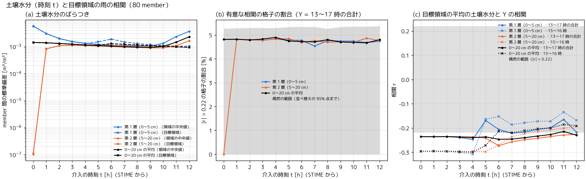

| 時刻 | 目標領域の平均の u（0〜20 cm）と Y の r（13〜17 時の合計 / 15〜16 時） | 目標領域の平均の u の member 間の標準偏差（第 1 層 / 0〜20 cm）[m³/m³] |
| --- | --- | --- |
| 0 時 | −0.24 / −0.30 | 0.00053 / 0.00013 |
| 4 時 | −0.24 / −0.30 | 0.00012 / 0.00011 |
| 8 時 | −0.24 / −0.21 | 0.00022 / 0.00018 |
| 12 時 | −0.23 / −0.19 | 0.00018 / 0.00014 |

- **土壌水分の member 間のばらつきは、ほとんどの場所でとても小さい**: 格子ごとの標準偏差の領域の中央値は 7〜10 時で約 0.001 m³/m³（平均は 0.20）。
  目標領域の中は 0.0010〜0.0015。ばらつきが大きい（0.05 以上）のは、member によって雨が降ったり降らなかったりした場所だけ。
  初期の摂動（`setup/init/perturb_soil.py`、一様分布 ±0.01、標準偏差 0.0058）より小さい（理由は 3.4）
- **格子ごとの相関は、どの時刻でも偶然と区別できない**: |r| > 0.22 の格子の割合は 4.5〜5.0%（偶然の 95% 点は 5.3〜5.4%）。ばらつきが大きい 0 時でも同じ。
  地図にもまとまった模様はなく、格子ごとにばらばらの値
- **目標領域で平均した土壌水分は、どの時刻でも雨と負の相関**: 13〜17 時の合計で −0.21〜−0.27、15〜16 時で −0.13〜−0.31。
  0〜4 時は第 1 層・第 2 層・0〜20 cm でほぼ同じ値（第 1 層の偏りがそのまま第 2 層へ移るため）。5 時以降、第 1 層の相関は弱まり、第 2 層・0〜20 cm は −0.2〜−0.27 を保つ
- 向きは「目標領域が湿っている member ほど雨が少ない」（負のフィードバックの向き）。|r| = 0.30 は 1 回の検定なら p ≈ 0.007 だが、
  3 種類 × 2 種類 × 13 時刻を試した中の値（ただし時刻どうしはほぼ同じ量を見ている）
- 目標領域で平均した土壌水分のばらつきはとても小さい（0.0001〜0.0005）。2 km の格子ごとに独立な摂動なので、100 格子で平均すると 10 分の 1 になる

#### 読み取り

- この 80 member の土壌水分には、共分散で「どこを湿らせればよいか」を見積もる材料がほとんどない。
  修正量の大きさは、おおよそ r × σ_u × (y* − Ȳ)/σ_Y × 1/2 で、σ_u ≈ 0.001 m³/m³ では 10⁻⁵ m³/m³ の桁になる。
  t_int から同化なしで予報し直しても、u（t_int の土壌水分）のばらつきは同じなので、この点は変わらない
- 雨に関係しているのは、2 km の格子ごとの土壌水分ではなく、20 km 程度で平均した土壌水分らしい（格子ごとの相関は雑音、平均すると向きのそろった相関が出る）
- 早い時刻に介入してもばらつきの点では得をしない: 20 km で平均した量のばらつきは、0 時でも 0.0005 と小さく、相関も 4 時までほぼ変わらない
- 20 km 程度の広がりを持つ摂動にすれば、効いている大きさの量のばらつきを直接大きくできる（→ 3.5）

### 3.4 土壌水分の動き（層ごと・ばらつき・水の収支）（2026-11-02）

**変えたもの**: なし。3.3 で土壌水分のばらつきが t_int までに薄まっていたので、その動きを 0〜24 時で追った。

#### 方法

- データ: result_m80（80 member と mdet）の各 cycle の 1 時間予報の history（10 分ごと）。`LAND_WATER`（7 層）・`PREC`・`LHFLX`・`LAND_RUNOFF`
- 層の厚さ: 上から 5・15・30・50・100・100・100 cm（history の `lzh`）。柱の貯水量 S = Σ 土壌水分 × 層の厚さ
- 蒸発 = LHFLX / 2.5×10⁶。水の収支の残り = S の変化 − (降水 − 蒸発 − 流出)
- ばらつきは、格子ごとの member 間の標準偏差の、領域の中央値（(a)）と 90% 点（(b)）
- スクリプト: `analysis/control/20261102_soil_cov/plot_soil_track.py`（ジョブ `plot_soil_track_job.sh`、Aquarius、ジョブ 10121400、約 1 時間 33 分）
- 出力: `20261102_soil_track/soil_track_target.png`・`soil_track_spread.png`・`soil_budget.png`・`soil_track.out`・`soil_track.npz`

#### 結果

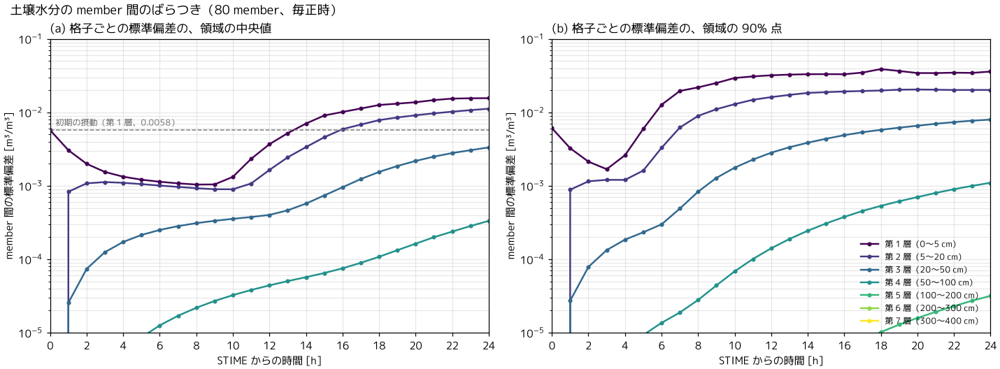

| 時刻 | 第 1 層（0〜5 cm） | 第 2 層（5〜20 cm） | 第 3 層（20〜50 cm） |
| --- | --- | --- | --- |
| 0 時 | 0.0057 | 0 | 0 |
| 1 時 | 0.0031 | 0.0008 | 0.0000 |
| 3 時 | 0.0015 | 0.0011 | 0.0001 |
| 8 時 | 0.0010 | 0.0009 | 0.0003 |
| 12 時 | 0.0037 | 0.0016 | 0.0004 |
| 16 時 | 0.0101 | 0.0059 | 0.0010 |
| 24 時 | 0.0156 | 0.0112 | 0.0033 |

（土壌水分の member 間の標準偏差 [m³/m³]。格子ごとの値の、領域の中央値。第 4 層より下は 24 時でも 0.0003 以下）

- **初期の摂動は 3 時間ほどで第 1 層と第 2 層に分かれ、両方とも約 0.001 になる**。第 1 層は 0〜3 時で 4 分の 1 に減り、第 2 層に移る（バケツモデルの層の間の水の移動）。
  8〜9 時が最小（第 1 層 0.0010）
- **10 時以降のばらつきの増加は、雨の違いによるもの**（member ごとに降った場所が違う）。24 時には第 1 層で 0.016 まで増え、初期の摂動の 3 倍になる
- **目標領域の土壌水分は、雨の前はほぼ一定でゆっくり乾く**: 第 1 層は 0 時 0.199 → 12 時 0.194。蒸発は約 0.1 mm/h（12 時間で 1.26 mm）
- **雨で第 1 層が 0.30 前後まで上がる**（mdet 0.31）。その後、数時間で第 2 層、十数時間で第 3 層へ浸み込む
- **水の収支は閉じている**: 残りは 24 時間で領域全体 −0.08 mm、目標領域 +0.01 mm（降水 12.7 mm・蒸発 2.6 mm・流出 2.4 mm に対して）

#### 読み取り

- 介入したい時刻（雨の前）に、ばらつきがちょうど最小になっている
- このモデルでは「雨 → 土壌水分」の向きが主で、土壌水分のばらつきは雨の違いの結果として生まれている
- 摂動を足すなら、第 1 層だけでは数時間で薄まる。第 1・2 層（0〜20 cm）に足すと、少なくとも数時間はばらつきが残る
- 雨の前の目標領域の潜熱は、領域全体より 10〜15 W/m² 少ない（約 1〜2 割）。この差を土壌水分で埋めるのに要る量の目安になる

### 3.5 パッチ型の土壌水分の摂動を入れたアンサンブル予報（2026-11-03）

**変えたもの**: 感度のアンサンブルを、**8 時に 20 km 四方のパッチごとの摂動（標準偏差 0.02、0〜20 cm）を入れ直し、同化なしで予報し直した 80 member** にした。
3.3 で 20 km 程度で平均した土壌水分が雨と関係していそうだったので、「土壌水分を振ると雨が動くか」を直接見た。
パッチ型はユーザーの選択。振幅・層・時刻は Claude の案。

#### 方法

- 初期値: result_m80 の 8 時の解析（80 member と mdet）。member にだけ、土壌水分の摂動を足した（mdet には足さない）
  - 20 km 四方（10 × 10 格子）のパッチごとに一様乱数（−0.035〜+0.035、標準偏差 0.02 m³/m³）。目標領域がちょうど 1 つのパッチに入るよう、切れ目を 5 格子ずらした
  - 第 1・2 層（0〜20 cm）に同じ値を足し、0〜0.5 に切り詰めた。member ごとに別の乱数の種（20261103 + member 番号）
- 予報: 準備の段階の cycle と同じ実行ファイル（`ensmodel/scale-rm_ens`、md5 655907ce…）と、同じ 8 時の物理設定で、8〜18 時を同化なしで 1 本の予報
  - history は 600 秒ごと、項目を 22 個に絞った（降水・地表フラックス・境界層の高さ・土壌水分・U・V・W・T・QV・PRES・MSE など）。restart は毎正時
  - 試験（2 member + mdet・1 時間、ジョブ 10123189）で、摂動なしの mdet が cycle の mdet の 9 時の history とビット単位で一致することを確かめた
- スクリプト: `control/20261103_patch_fcst/make_patch_fcst.py`（入力作り。ジョブ `make_job.sh`、Aquarius、10123210）、`control/20261103_patch_fcst/run_fcst.sh`（予報。Wisteria、324 ノード、ジョブ 10123273、15 分）
- 出力: `/work/gv42/v42013/20260923_enkc_convection/phase9_patch_t08/`（302 GB。`init/`・`hist/`・`restart/`・`perturbation.npz`。0001〜0080 = member、0081 = mdet）
- 解析: `analysis/control/20261103_patch_fcst/check_patch_fcst.py`（ログインノード、約 2 分）→ `20261103_patch_fcst/patch_target.png`・`patch_corr.png`・`patch_map.png`・`patch_fcst.out`

#### 結果

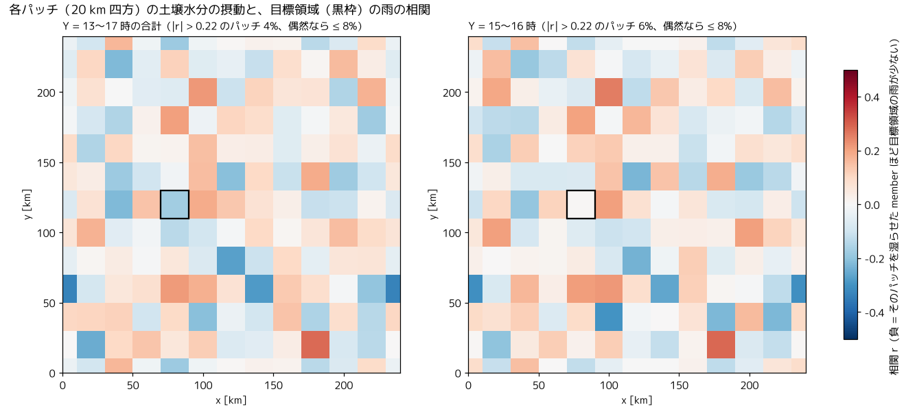

目標領域のパッチの摂動 u（標準偏差 0.0197）と、目標領域の 1 時間平均の量の相関（`patch_fcst.out` から。図には雨だけを描いている）:

| 時刻 | 潜熱 | ボーエン比 | 境界層の高さ | 降水 |
| --- | --- | --- | --- | --- |
| 8〜9 時 | +0.92 | −0.99 | −0.36 | — |
| 9〜10 時 | +0.83 | −0.98 | −0.57 | — |
| 11〜12 時 | +0.59 | −0.98 | −0.40 | −0.10 |
| 12〜13 時 | +0.50 | −0.90 | −0.06 | −0.38 |
| 13〜14 時 | +0.70 | −0.75 | +0.30 | **−0.66** |
| 14〜15 時 | +0.75 | −0.44 | +0.34 | −0.44 |
| 15〜16 時 | +0.27 | −0.00 | −0.00 | +0.01 |
| 16〜17 時 | +0.32 | −0.14 | −0.15 | −0.04 |

- **土壌水分 → ボーエン比は、ほぼ決定論的**（目標領域で平均した量どうしで r = −0.99〜−0.90、雨の前の 8〜13 時）。湿らせると潜熱が増え、ボーエン比が下がり、境界層の発達が抑えられる（12 時ごろの最大が約 790 m → 730 m）
- **雨の降り始めは遅れる**: 湿らせた半分の member では、境界層が崩れる（雨が始まる）のが 0.3〜0.5 時間遅く、13〜14 時の雨と r = −0.66、14〜15 時と −0.44
- **ピークは変わらない**: 15〜16 時の雨との相関は +0.01。ピークの強さ（約 6 mm/h）は、湿らせた半分と乾かした半分でほぼ同じ
- 13〜17 時の合計との相関は −0.17（並べ替えで |r| 以上になる割合 0.14。偶然と区別できない）。傾きは −34 mm/(m³/m³)（0.01 湿らせると −0.34 mm）
- 目標領域以外のパッチの相関の地図は、偶然と区別できない（|r| > 0.22 のパッチ 4%、偶然の 95% 点 8%）。どこか別の場所を湿らせると効く、という形は見えない
- 目標領域の雨（13〜17 時の合計）: member 平均 8.95 mm、標準偏差 3.90 mm（1.29〜20.06 mm）。準備の段階の cycle（8.75 ± 3.54 mm）とほぼ同じばらつきで、
  **パッチの摂動を入れても雨のばらつきはほとんど増えない**（雨の違いは、土壌水分ではなく大気の違いとカオスから来ている）
- mdet（摂動なし）の 13〜17 時の合計は 8.06 mm で、cycle の中の mdet（12.64 mm）と違う。9 時まではビット単位で一致したので、
  1 本の予報と cycle（毎時 restart から再開する）の違いが、カオスで育ったものと考えられる（未確認）

#### 読み取り（解釈は相談中）

- ボーエン比を代理の目標にした制御の、内側（土壌水分 → ボーエン比）は成り立つ
- ただし、ボーエン比を下げて効くのは雨の**降り始め**で、**ピーク**には効いていない。浅い境界層で対流のきっかけが遅れるが、雨の本体はパッチの外から来る（またはパッチの外の条件で決まる）可能性がある
- 雨を目標にした EnKC では、ピークや合計に対して土壌水分の効き方が見えない（相関がほぼ 0 か弱い）

### 3.6 LCL・LCL の不足分と、降り始め（2026-11-03）

**変えたもの**: 見る量を、LCL と「LCL − 境界層の高さ」（LCL の不足分 D）に（ユーザーの依頼）。データは 3.5 のパッチの摂動の予報。
正と負のフィードバック（Liu et al. 2022 の Fig. 2・4）の両方にかかわる量として選んだ。
湿らせると LCL が下がる（正のフィードバック側）、乾かすと境界層が厚くなる（負のフィードバック側）の両方が D の上で綱引きをする、という考え方。

#### 方法

- データ: phase9_patch_t08（80 member と mdet）。history の T2・Q2・SFC_PRES・PBLH・PREC（10 分ごと）
- LCL: 格子ごとに、露点（Bolton 1980）、凝結する温度（Bolton 1980 の式 15）、乾燥断熱で高さ [m]。D = LCL − PBLH。目標領域で平均。あわせて D ≤ 0 の格子の割合
- 雨の降り始め: 目標領域の平均降水強度が 1 mm/h を初めて超えた時刻
- スクリプト: `analysis/control/20261103_patch_fcst/check_patch_lcl.py`（ログインノード、数分）→ `20261103_patch_fcst/patch_lcl.png`・`patch_lcl.out`・`patch_lcl.npz`

#### 結果

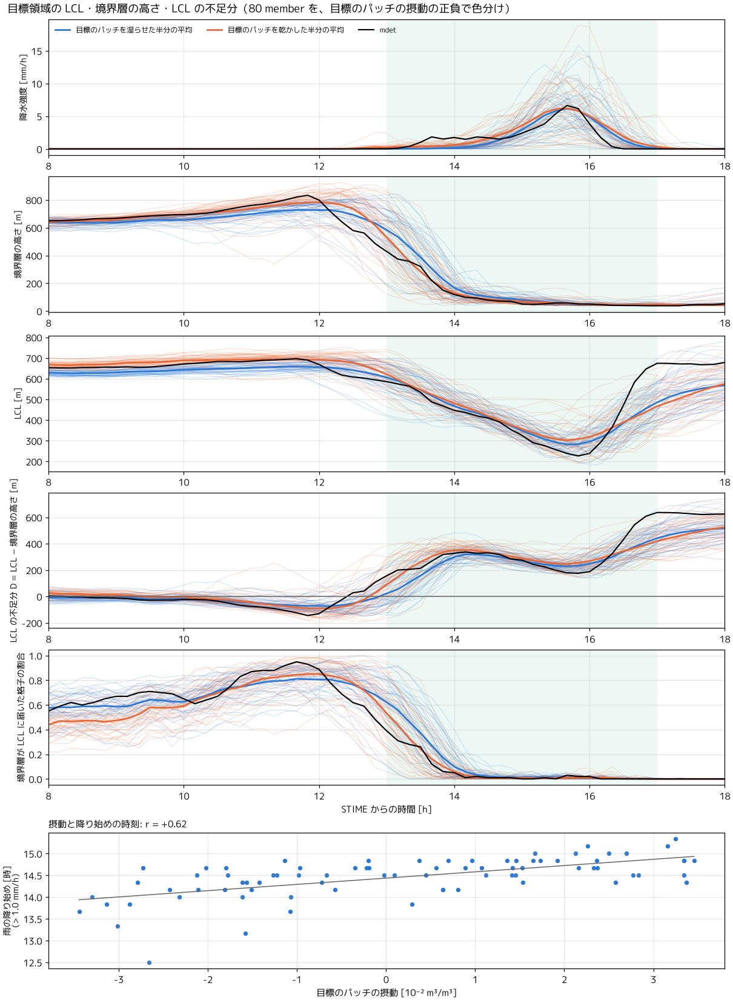

- **湿らせると雨の降り始めが遅れる**: 目標のパッチの摂動と降り始めの時刻の相関は r = +0.62（0.01 m³/m³ 湿らせると約 9 分遅れる）。
  降り始めは member の平均 14.5 時（標準偏差 0.46 時間、12.5〜15.3 時）
- 土壌水分との相関（9〜10 時）: 2 m 比湿 +0.94、LCL −0.94、2 m 気温 −0.76、境界層の高さ −0.57、D −0.45。
  湿らせると、下層が湿って冷え、LCL が下がり、境界層は浅くなる。**LCL の下がり方が境界層の下がり方より大きく、D は小さくなる**（8〜9 時 r = −0.61）
- つまり D で見ると「湿らせると対流が始まりやすくなる」向きだが、実際には降り始めが**遅れた**。D は降り始めの時刻を説明しない
- D は 9〜12 時にはすでに負（目標領域の 6〜8 割の格子で境界層が LCL に届いている）。雨の 2〜3 時間前から「LCL に届く」条件は満たされていて、
  深い対流の始まりを決めているのは、この条件ではない
- 土壌水分の影響を除いた偏相関（各量と降り始めの時刻、8〜11 時）は、LCL・境界層の高さ・D・T2・Q2 のいずれも |r| ≤ 0.2。
  これらの量は、土壌水分の摂動を写しているだけで、それ以上に降り始めを説明する情報は持っていない
- 追加: 目標のパッチの摂動 u_t と、まわり 8 パッチの摂動の平均 u_s の両方で、降り始めの時刻を回帰した（`patch_lcl.npz` と `perturbation.npz` から。その場の計算）。
  u_t の標準偏差 0.0197、u_s 0.0067、両者の相関 0.07
  - 降り始め: u_t は 0.01 m³/m³ あたり +8.8 分（遅れる）、u_s は 0.01 あたり −9.4 分（早まる）。大きさがほぼ同じで向きが逆。
    差 u_t − u_s だけで回帰しても説明できる割合は同じ（R² = 0.44）
  - 13〜14 時の雨も同じ形（R² = 0.50）。13〜17 時の合計はどちらでもほとんど説明できない（R² = 0.03）

#### 読み取り（解釈は相談中）

- 効いているのは目標領域の湿り具合そのものより、**まわりとの差**らしい。ただし u_s のばらつきは小さく（8 パッチの平均）、その係数の不確かさは u_t より大きい
- 湿らせた目標のパッチは、まわりより冷たく湿った場所になる（2 m 気温 −0.76）。論文 Fig. 1 の「冷たく湿った土壌の上では対流が起きにくく、
  乾いて暖かい所に対流が立つ」不均一さの効果（メソスケールの循環）が効いている可能性がある。1 次元の LCL・境界層の考え方（D）では説明できない
- 確かめるには、目標領域とまわりの気温の差や、下層の収束（U・V を出力してある）を見る

### 3.7 格子ごとのボーエン比の相関の地図（2026-11-04）

**変えたもの**: 見る量を、目標領域で平均したボーエン比から、**格子ごとのボーエン比**に。データは 3.5 のパッチの摂動の予報。

#### 方法

- データ: phase9_patch_t08 の 80 member。標本は 80 member
- ボーエン比 B: 格子ごとに、10〜11 時の 1 時間平均の顕熱 / 潜熱
- 地図 (a): 格子ごとの、土壌水分の摂動 u（第 1 層、perturbation.npz）と B の相関
- 地図 (b): 格子ごとの B と、目標領域の雨 Y（13〜17 時の合計）の相関
- スクリプト: `analysis/control/20261103_patch_fcst/check_patch_bowen_map.py`（ジョブ `check_patch_bowen_map_job.sh`、Aquarius、ジョブ 10138994、約 3 分）
- 出力: `20261103_patch_fcst/patch_bowen_map_10.png`・`patch_bowen_map_10.npz`・`patch_bowen_map_10.out`

#### 結果

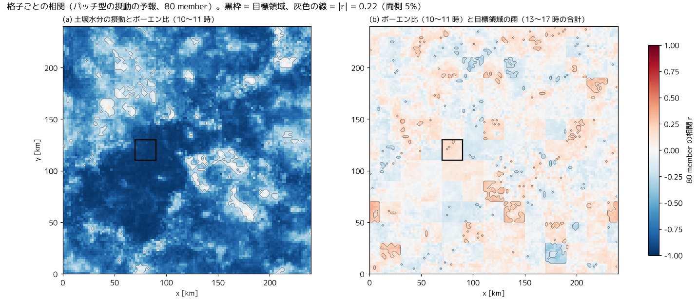

- (a) 土壌水分の摂動とボーエン比: 領域の中央値 r = −0.72（10% 点 −0.93、90% 点 −0.32）、r² の中央値 0.52。
  目標領域の格子の平均は −0.94。目標領域のまわりは −0.9 前後と強いが、場所によっては −0.3 程度まで弱い（白っぽい斑点）
- (b) ボーエン比と目標領域の雨: |r| > 0.22 の格子は 5.2% で、偶然（約 5%）と区別できない。目標領域の格子の平均 +0.15、
  目標領域で平均したボーエン比と Y の相関 +0.16。どこのボーエン比も、目標領域の雨を説明しない

#### 読み取り（解釈は相談中）

- 3.5 の「土壌水分とボーエン比の相関 −0.99」は、目標領域で平均した量どうしの値。格子ごとでは目標領域で −0.94、領域全体の中央値では −0.72 と弱くなる
- 相関が弱い斑点の理由は未確認。候補: member の解析の土壌水分そのものの違い（それまでの雨で育ったばらつき。u には入っていない）、雲や雨によるフラックスの変化
- ボーエン比・境界層の高さ・LCL は土壌水分でほぼ決まる量で、雨について土壌水分以上の情報を持たない（3.6 の偏相関とあわせて）。
  代理の目標にしても、雨の動き方は土壌水分を直接変えたときと変わらない

### 3.8 EnKC による制御実験（8 時に 1 回、mdet に介入）（2026-11-03）

**変えたもの**: 実際に mdet に介入した。感度のアンサンブルは 3.5。あわせて次の 3 つを変えて比べた。

| 変えたもの | 比べた設定 |
| --- | --- |
| 目標 | 13〜17 時の合計（基準、y* = 8 mm）／ 13〜14 時の雨（降り始め、y* = 0 mm、仮に置いた値） |
| 状態の表し方 | full：全格子で修正量の式をそのまま使う ／ local：目標のパッチと周りの 8 パッチ（3 × 3 パッチ）の平均の 2 自由度に絞り、それぞれ一様に足す（外は 0） |
| 向き | 湿らせるだけ（clip：負の修正を 0 にする。基準） ／ 切らない（noclip） |

対照として、修正なし（流し直し）と、local・clip の修正量をランダムな場所へずらした本（random）も流した。

#### 方法

- 修正量: `control/20261103_enkc_once/make_control.py`（`DRY=1` で修正量の表だけ出す。ログインノード、数秒）
  - 状態は第 1・2 層の土壌水分（member の違い = パッチの摂動。8 時の解析そのもののばらつき約 0.001 は無視）。両層に同じ修正量を足し、0〜0.5 に切り詰める
  - 予測 ΔY: Y の、目標のパッチ・周りの 8 パッチの平均への重回帰から
- 入力: 同じスクリプト（ログインノード、約 1 分）→ `/work/gv42/v42013/20260923_enkc_convection/phase9_control_t08/`（11 本）
  - 0001 修正なし（流し直し）、0002〜0006 目標 13〜14 時（full・clip / full・noclip / local・clip / local・noclip / random）、0007〜0011 目標 13〜17 時（同じ並び）
  - full では、0.5 に届いた格子で修正が最大 0.0018 切られた
  - random は local・clip の修正量を、パッチ単位でずらした位置（13〜14 時: (9, 8)、13〜17 時: (3, 11) パッチ）へ動かしたもの
- 予報: `pjsub -L rscgrp=debug-o,node=144,elapse=00:30:00 --mpi proc=576 -x OUT=… control/20261103_patch_fcst/run_fcst.sh`（job 10131840、約 5 分）
- 解析: `analysis/control/20261103_enkc_once/check_control.py`（ログインノード）→ `20261103_enkc_once/control_target.png`・`20261103_enkc_once/control.out`

#### 結果：修正量

| | 13〜14 時（y* = 0） | 13〜17 時（y* = 8） |
| --- | --- | --- |
| Ȳ ± σ_Y [mm] | 0.25 ± 0.28 | 8.95 ± 3.93 |
| mdet [mm]（80 member 中の順位、小さいほうから） | 1.10（79 番目） | 8.06（33 番目） |
| 相関: 目標のパッチ / 周りの 8 パッチ | −0.66 / +0.19 | −0.17 / +0.06 |
| 目標のパッチの修正量 [m³/m³] | +0.0059 | +0.0004 |
| 周りの 8 パッチの修正量（切らない場合） | −0.0006 | −0.00005 |
| 予測 ΔY（local・切る） [mm] | −0.056 | −0.015 |

- 修正量は、member のばらつき（0.02）よりずっと小さい（13〜14 時で約 0.3 倍、13〜17 時で約 0.02 倍）。予測 ΔY も σ_Y の 2〜20% 程度。
  修正量が小さいのは、目標までの差 |y* − Ȳ| が σ_Y に比べて小さい（0.9σ_Y と 0.24σ_Y）ことと、σ_R = σ_Y で差の半分しか詰めにいかないこと
- 周りの 8 パッチは「乾かす」向きを求めるので、**湿らせる向きだけにすると周りの修正は 0 に切られる**。full と local の違いは、
  目標のパッチの外の小さな雑音（|Δθ| の平均 0.0004）だけになり、目標のパッチの修正量は同じ
- 13〜14 時では、mdet（摂動なし）が 80 member のほぼ最大で、アンサンブルの分布の外にある（member はみなパッチの不均一さを持ち、mdet は持たない）

#### 結果：制御実験

| 本 | 13〜14 時 [mm] | 差 | 13〜17 時 [mm] | 差 | 降り始めの差 [分] | 予測 ΔY [mm] |
| --- | --- | --- | --- | --- | --- | --- |
| 修正なし（もとの mdet・流し直しとも） | 1.101 | | 8.055 | | （13.50 時） | |
| 13〜14 時 full・clip | 0.310 | −0.79 | 12.57 | +4.51 | +40 | −0.056 |
| 13〜14 時 full・noclip | 0.332 | −0.77 | 12.15 | +4.09 | +40 | −0.062 |
| 13〜14 時 local・clip | 0.599 | −0.50 | 9.05 | +1.00 | +50 | −0.056 |
| 13〜14 時 local・noclip | 0.215 | −0.89 | 9.21 | +1.16 | +60 | −0.062 |
| 13〜14 時 random | 0.639 | −0.46 | 6.68 | −1.37 | +30 | 0 |
| 13〜17 時 full・clip | 0.543 | −0.56 | 9.14 | +1.09 | +10 | −0.010 |
| 13〜17 時 full・noclip | 0.613 | −0.49 | 13.89 | +5.83 | +30 | −0.016 |
| 13〜17 時 local・clip | 0.672 | −0.43 | 13.20 | +5.15 | +30 | −0.015 |
| 13〜17 時 local・noclip | 0.617 | −0.48 | 7.48 | −0.58 | +10 | −0.016 |
| 13〜17 時 random | 0.667 | −0.43 | 11.00 | +2.95 | +10 | 0 |

- 修正なしの流し直しは、もとの mdet とビット単位で一致した（差は修正量だけによる）
- **修正の大きさ（0.0004〜0.006）に比べて、雨の変化がはるかに大きく、向きも本ごとにばらばら**。13〜17 時の合計の差は 10 本で平均 +2.4 mm、標準偏差 2.5 mm（予測は −0.01〜−0.06 mm）。
  遠くのランダムな場所に足した本（予測 0）も、同じ程度に変わった
- 13〜14 時の雨は、どの本でも 0.4〜0.9 mm 減り、降り始めが 10〜60 分遅れた（random も含む）。mdet は 80 member の中でも早く降る側（79 番目）で、
  どんな小さな修正でもアンサンブルのふつうの値（Ȳ = 0.25 mm）の側へ戻る、と読める。EnKC の修正の効果とは区別できない
- full と local、clip と noclip の違いも、この揺れに埋もれて見えない

#### 読み取り（解釈は相談中）

- 8 時に 1 回、土壌水分を 0.0004〜0.006 だけ変えると、雨はカオスで σ_Y 程度に変わる（バタフライ効果）。EnKC が求めた修正の効果（予測 ΔY）は、その揺れより 2 桁小さい
- この設定（8 時に 1 回、σ_R = σ_Y、目標までの差が σ_Y 以下）では、EnKC による雨の制御は検出できない
- 台風の制御（Sawada et al. 2026）との違い: 台風では、良い道を決めている大気の量（最下層の水蒸気）を直接動かし、1 時間先を見て毎時押し直していた。
  今回は、間接的な量（土壌水分）を、5 時間先を見て 1 回だけ押した。この結果を受けて、方針を逐次の制御に変えた（1.3）

### 3.9 逐次の制御（MPC）の実装と本番（2026-11-07。LETKC の正規の流れに乗せた。r080 と制御なしの 80 member・6 cycle まで済み）

**変えたもの**: 1.3 の設定（毎時の介入、T_c = 1 時間、Y = t + 45〜75 分の積算、y* = 0.8 Ȳ、σ_R = σ_Y、土壌水分のばらつきは足さない）を、
LETKC の正規の流れ（controltarget → 観測演算子 → QC → 局所 ETKF → 書き出し・obsdep）の上で実装した。
最初の実装（`letkc/soil_control.f90`。流れを全部迂回し、mdet の増分を member にも足していた）は消した。
作業の計画と各タスクの記録: `20261107_letkc_ctl_plan.md`。

#### 中身

- 制御目標: controltarget の新しい要素 19001（領域で平均し、時間の窓で積算する）。種類 1 は `&PARAM_CTLTARGET`（`config.nml.letkc`）の行 1:
  PREC、中心 x = 80 km・y = 120 km から ±10 km（100 格子）、窓 t + 45〜75 分（5 分平均 × 6）、相対目標・相対誤差
  （controltarget の値 0.8・誤差 1.0 → y* = 0.8 Ȳ、σ_R = 1.0 σ_Y。Ȳ・σ_Y は member の H(x)、mdet は入れない）
- 観測演算子: `letkc/obsope_tools_ctl.f90`（LETKF の `obs/` は変えていない）。history は全体 5 分ごと・スロットも 5 分（案 A）、PREC は 5 分の時間平均
- 修正: `&PARAM_LETKC_CONTROL` で、要素 19001 の目標から LAND_WATER の第 1・2 層だけを、増やす向きだけ・0〜0.5 で修正（λ = 0、`HORI_LOCAL = 1.0D6` = 領域全体）。
  member は ETKF の変換（`RELAX_ALPHA = 1` なので平均の移動だけ、ばらつきは第一推定のまま）、mdet は y* − H(x_mdet) とゲイン（今の LETKC のまま）。
  向きの判定は mdet の修正量で行い、戻す点は member・mdet とも同じ
- 予報は t + 75 分まで（`SENS_CYCLEFLEN=4500`）。終わりの restart は step 3・7 の後に消す
- 投入: `control/20261107_mpc_soil/submit.sh <実験名> [RATIO=… SIGMAR_FACTOR=… LAMBDA=… HORI_LOCAL=… …]`。
  RATIO・SIGMAR_FACTOR は controltarget の値・誤差に書き、LAMBDA・HORI_LOCAL は実験用の LETKC の設定（`$OUT/config.nml.letkc`、`SENS_LETKC_NML`）に書く。
  初期値は result_m80 の 12 時の解析、12〜17 時に毎時介入（6 cycle）。観測は修正後の mdet から毎 cycle 作る。
  比べる相手は `CONTROL=0`（制御なし）。controltarget の値を −1.0（ありえない値）にし、種類 1 を絶対値の目標・`REJECT_NEGDEP` にして、
  目標を QC で必ず落とす（`RATIO=1.0` は、mdet が Ȳ − Y_mdet で押されるので制御なしにならない）
- 結果: `/work/gv42/v42013/20260923_enkc_convection/mpc_soil/<実験名>/`。Y・y*・σ_R は obsdep（`obsdep/obsdepcont_<時刻>.dat`）と、
  ジョブの出力（`exp/<ジョブ>_cycle_<時刻>/cycle_job.sh.<ジョブ>.out` の `CTLTARGET` の行）に残る。修正量 = anal − gues（mdet は `gues/mdet`）

#### 試験（2026-11-07、`mpc_soil/test_m2`、ジョブ 10188438）

出力は 2026-11-09 に消した。検算の出力だけ `mpc_soil/test_m2_check_letkc_ctl_test.txt` に残す。

2 member・1 cycle（12 → 13 時）・debug-o 144 ノード、約 8 分。配管の確認が目的（2 member なので統計の意味はない）。

- 全段階（予報 → LETKC → 予報し直し → obsmake → LETKF）が正常に終わった。SCALE は PREC の時間平均を受け付けた（`TAVERAGE is obsolete` の WARN だけ）
- 制御目標は ncell = 100・スロット 6 で QC を通り、obsdep に要素 19001 が qc = 0、omb = y* − Ȳ、oma = undef で出た
- H(x): member 1: 1.08E−03、member 2: 5.75E−02、mdet: 3.39E−02 mm → Ȳ = 2.93E−02、σ_Y = 3.99E−02、y* = 2.34E−02、σ_R = 3.99E−02
- LAND_WATER の第 1 層は 14,400 点のうち 7,138 点が増え（max 2.9E−02）、第 2 層は 7,034 点（max 1.0E−02）。第 3〜7 層は変わらない
- Python の検算（`analysis/control/20261107_mpc_soil/check_letkc_ctl_test.py`）: history から計算した Y は H(x) と 7 桁で一致。
  ETKF の式（観測 1 つ）と制約から出した修正量は、mdet・member とも anal − gues と 1E−9 以内で一致
- 残っていること: Ȳ・σ_Y・y*・σ_R の `[Info]` の行がジョブの出力に出ない（書くプロセスの `LOG_OUT` が偽。値は obsdep にある）。
  `HIST_CLEAN=1`（本番の既定）では member の修正量は残らない

#### 本番（2026-11-07、`mpc_soil/r080`・`mpc_soil/nocontrol`）

80 member・6 cycle（12〜17 時に毎時介入、12 → 18 時）・x-large-o。どちらも約 1 時間 5 分（r080: ジョブ 10188896、nocontrol: ジョブ 10189138）。
r080 は RATIO = 0.8・SIGMAR_FACTOR = 1.0・λ = 0・HORI_LOCAL = 1.0D6、nocontrol は `CONTROL=0`。
（`RATIO=1.0` の r100 も投げたが、制御なしにならないので途中で止めた。出力は 2026-11-09 に消した）

- 解析: `analysis/control/20261107_mpc_soil/compare_mpc_soil.py`（ログインノード、約 15 秒。`FIGDIR=../docs/control/20261107_mpc_soil` で図 `mpc_target.png`）。
  各 cycle の hist/（修正のあとの予報し直し）の mdet・mean から、目標領域の PREC を積算
- 6 cycle とも全段階が正常に終わった。nocontrol では目標が毎 cycle QC で落ち（`NOBS = 0`）、LAND_WATER は 1 点も変わっていない
- 同化の第一推定の RMSE（U・V・T、全体）は、r080 で 0.251〜0.257・0.251〜0.261・0.187〜0.194、nocontrol で 0.251〜0.254・0.250〜0.254・0.185〜0.192。
  制御で同化の誤差は増えていない

**制御目標と修正量（r080、obsdep と LETKC のログから）**

| t | Ȳ（修正前の member）[mm] | σ_Y = σ_R | y* | 第 1 層の max \|Δθ\|/σ | 第 1 層の max \|Δθ\| | 増えた点 / 戻した点（14,400 点のうち） |
| --- | --- | --- | --- | --- | --- | --- |
| 12 | 0.044 | 0.058 | 0.035 | 0.005 | 3.6E−04 | 6,441 / 7,957 |
| 13 | 0.134 | 0.123 | 0.107 | 1.78 | 7.7E−02 | 7,594 / 6,799 |
| 14 | 1.281 | 0.786 | 1.025 | 0.070 | 3.5E−03 | 7,515 / 6,883 |
| 15 | 2.975 | 1.734 | 2.380 | 0.24 | 1.2E−02 | 7,475 / 6,925 |
| 16 | 0.129 | 0.237 | 0.103 | 0.13 | 8.0E−03 | 5,959 / 8,440 |
| 17 | 2E−08 | 2E−07 | 2E−08 | 0.044 | 1.5E−03 | 3,759 / 10,640 |

- 戻した点は、mdet の修正量が負（乾かす向き）の点。どの cycle でもほぼ半分が戻された。第 2 層もほぼ同じ（max \|Δθ\|/σ は第 1 層とほぼ同じ）
- 13 時の修正がいちばん大きい。Phase 8 の追加の確認で、mdet がアンサンブルの外にあった時刻（`docs/setup/phase8/20261107_mdet_rank.md`）

**目標領域の雨（mdet、修正のあとの予報）**

| t | r080: Y（t+45〜75 分） | nocontrol: Y | r080: t〜t+60 分 | nocontrol: t〜t+60 分 |
| --- | --- | --- | --- | --- |
| 12 | 0.034 | 0.034 | 0.016 | 0.016 |
| 13 | 0.815 | 0.845 | 0.969 | 0.989 |
| 14 | 1.264 | 1.110 | 1.230 | 1.144 |
| 15 | 4.283 | 4.063 | 6.921 | 5.568 |
| 16 | 0.003 | 0.061 | 2.542 | 3.427 |
| 17 | 0.000 | 0.000 | 0.000 | 0.001 |
| 12〜18 時の合計 | | | **11.68** | **11.14** |

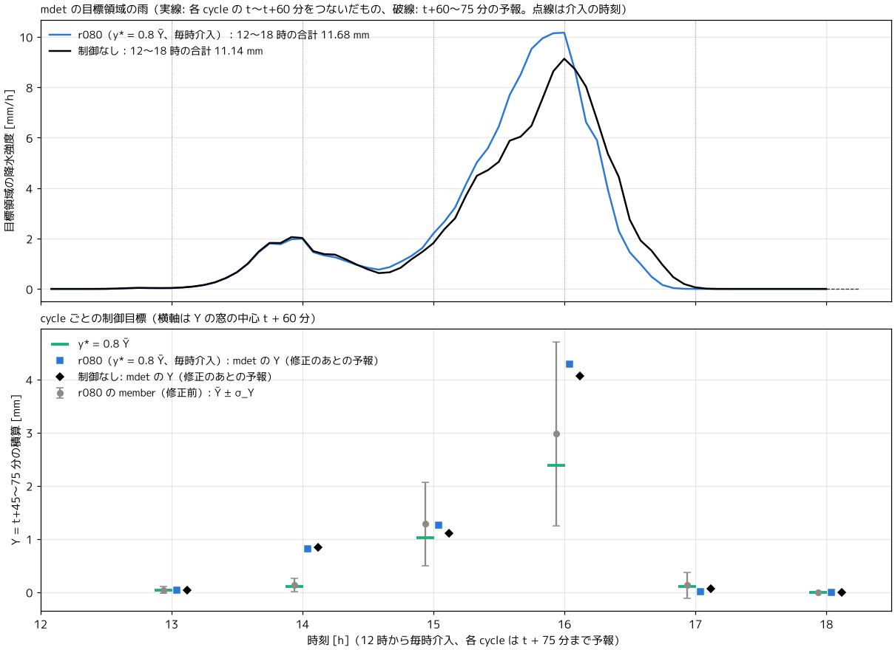

- 12〜18 時に実際に降った雨（mdet の t〜t+60 分をつないだもの）は、r080 が 11.68 mm、nocontrol が 11.14 mm。**制御したほうが 0.53 mm（4.8%）多い**
- 同じ初期値から始まるのは 12 時の cycle だけ。12 時の修正（max 3.6E−04）で Y は 0.0343 → 0.0339 mm（−1%）。13 時からは、観測も修正後の mdet から作るので、
  2 本は別の道を進んでおり、cycle ごとの差は修正の効果だけではない
- mdet の Y は、修正のあとでも member の Ȳ・y* より大きいことが多い（13 時: 0.815 に対し y* = 0.107、15 時: 4.28 に対し y* = 2.38）

#### 読み取り（解釈は相談中）

- この設定（RATIO = 0.8、σ_R = σ_Y、湿らせる向きだけ、λ = 0）では、毎時押し直しても、目標領域の雨は減らなかった
- 修正量は 13 時を除いて member のばらつきの 0.25 倍以下。3.8 節と同じく、修正の効果とカオスによる揺れとを、この 1 本ずつの比較では分けられない

### 3.10 ピークの前後の 3 cycle だけ介入（2026-11-09〜。T_c = 1 時間・3 時間）

**変えたもの**: 3.9 の本番（毎時介入）から、介入する cycle を、Y の窓の中心 t + T_c が 15・16・17 時になる 3 cycle だけにした
（nocontrol の mdet の目標領域の雨は 16 時ごろに最大。15:55〜16:05 に約 9 mm/h）。T_c = 1 時間では t = 14・15・16 時、T_c = 3 時間では t = 12・13・14 時。
ほかの cycle は同化だけで制御なし。どれも 12 → 18 時を通す（result_m80 と nocontrol の解析は同じ時刻でもビット単位では一致せず、
nocontrol の member の解析は残っていないので、途中の時刻からは始めない）。そのほかの設定は 3.9 の r080 と同じ。

- 実装: `submit.sh` の `CTL_HOURS`（例 `CTL_HOURS="14 15 16"`）。介入する時刻だけ `obs/controltarget_<t>` を置き、`SENS_CTL_TIMES=1` で
  LETKC が cycle ごとのファイルを読む（`src/func_cycle_static.sh`。設定しなければ今までどおり全 cycle で `controltarget`）。
  ファイルのない cycle は LETKC が警告（`FILE … NOT FOUND`）を出して観測 0 個になり、制御はかからない
- 比べる相手: どちらも 3.9 の nocontrol（と毎時介入の r080）。下の「本番」を参照

#### 試験（2026-11-09、`mpc_soil/test_p3`、ジョブ 10239801）

2 member・2 cycle（12 時は介入なし、13 時は介入あり）・debug-o、約 11 分。2 cycle とも全段階が正常に終わった。

- 12 時: LETKC は `controltarget_20000131120000 NOT FOUND` の警告を出し、目標の NOBS = 0。obsdepcont は空。mdet の LAND_WATER は anal − gues = 0（全 144 ファイル）
- 13 時: 目標を 1 個読み（ncell = 100、スロット 6）、NOBS = 1。obsdepcont に y* = 0.0305、σ_R = 0.0017、omb = −0.0076。mdet の LAND_WATER が変わった（max 0.34。2 member なので大きさに意味はない）

#### 本番（2026-11-12 投入）

`SENS_NNODES=1116`（31 本 × 36 ノード、82 本を 3 回に分けて流す）で large-o に入れた（既定の 1476 ノードは x-large-o）。1 本ごとの SCALE（144 プロセス）は変わらない。
TIME_LIMIT は r080 のログ（1 cycle 約 11 分。予報は 2 回で約 1.7 分、残りはコピー・削除）と tc3_test_m2・test_m2 の比（約 1.75 倍）からの見積もり
（p3_tc1 約 1.2 時間、p3_tc3 約 2 時間）に余裕を足した値（`pjalter` は使えないので、11-11 に投げた分を取り消して投げ直した）。

| 名前 | TC | 介入 | ジョブ | TIME_LIMIT |
| --- | --- | --- | --- | --- |
| `p3_tc1` | 3600 | 14・15・16 時 | 10304440 | 02:30:00 |
| `p3_tc3` | 10800 | 12・13・14 時 | 10304441 | 03:30:00 |

T_c = 3 時間の制御なし（`tc3_nocontrol`）は流さない。合計の雨（各 cycle の t〜t+60 分をつないだもの）は予報の長さによらないので 3.9 の nocontrol と比べ、
修正前の Ȳ・σ_Y は p3_tc3 の obsdep を使う。同じ計算が再現するかは、p3_tc1 の 12・13 時（介入なし）の解析を nocontrol と比べて確かめる

どちらも正常に終わった（p3_tc1: 11-14 00:44、p3_tc3: 11-14 03:32 に完了）。p3_tc3 の obsdepcont は 12・13・14 時だけが空でない。

#### 結果：目標領域の雨（2026-11-16）

`compare_mpc_soil.py` に、予報が Y の窓まで届かない実験（T_c = 3 時間のときの nocontrol・r080）の Y を描かないようにする変更を入れた。
図は `FIGNAME` で名前を変えて出した（ログインノード、各 15 秒ほど）:
`FIGNAME=mpc_target_p3_tc1.png … --runs p3_tc1 r080 nocontrol --tc 3600`、`FIGNAME=mpc_target_p3_tc3.png … --runs p3_tc3 nocontrol --tc 10800`

| t | p3_tc1: Ȳ / y* | p3_tc1: Y_mdet | p3_tc1: t〜t+60 分 | p3_tc3: Ȳ / y* | p3_tc3: Y_mdet | p3_tc3: t〜t+60 分 | nocontrol: t〜t+60 分 |
| --- | --- | --- | --- | --- | --- | --- | --- |
| 12 | — | 0.034 | 0.016 | 1.439 / 1.151 | 1.417 | 0.016 | 0.016 |
| 13 | — | 0.845 | 0.989 | 2.763 / 2.211 | 3.423 | 0.983 | 0.989 |
| 14 | 1.348 / 1.079 | 1.109 | 1.144 | 0.097 / 0.077 | 0.003 | 1.269 | 1.144 |
| 15 | 3.115 / 2.492 | 4.071 | 5.563 | — | 0.000 | 6.643 | 5.568 |
| 16 | 0.206 / 0.165 | 0.060 | 3.530 | — | 0.000 | 1.710 | 3.427 |
| 17 | — | 0.000 | 0.001 | — | 0.000 | 0.000 | 0.001 |
| 12〜18 時の合計 | | | **11.24** | | | **10.62** | **11.14** |

Ȳ・y* は修正前の member（obsdep）、Y_mdet は修正のあとの mdet の予報で、Y の窓は p3_tc1 が t+45〜75 分、p3_tc3 が t+165〜195 分。単位は mm。

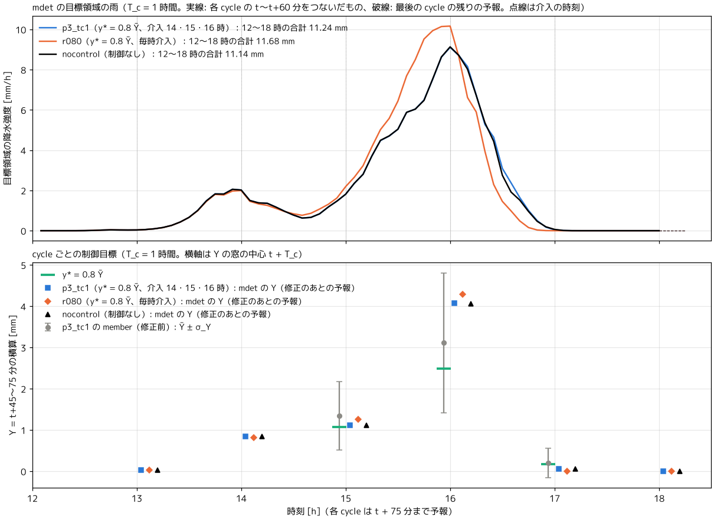

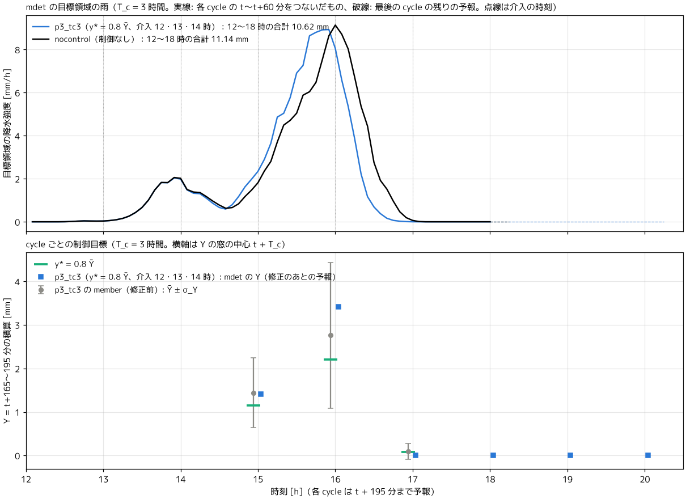

- 12〜18 時の合計は、p3_tc1 が 11.24 mm（nocontrol より +0.10 mm、+0.9%）、p3_tc3 が 10.62 mm（−0.52 mm、−4.7%）。r080（毎時介入）は 11.68 mm
- p3_tc3 は、ピークが nocontrol より 10 分ほど早く（15:50 ごろ）、少し弱い（約 8.9 mm/h。nocontrol は 9.1 mm/h）。16 時台の雨が減った
- p3_tc1 の雨の時系列は、介入した 14〜16 時も nocontrol とほとんど重なる
- 再現の確認: p3_tc1 の 12・13 時（介入なし）の mdet の雨は nocontrol と 4 桁で一致（12 時 0.0159、13 時 0.9887 mm）。
  ただし 13 時の member 平均の Y は 0.0537 と 0.0571 で一致しない（12 時の解析がビット単位では一致しないので、member が 1 時間でずれたと思われる）

#### 結果：どこでどれだけ土壌水分を増やしたか（2026-11-16）

`analysis/control/20261107_mpc_soil/plot_increment.py`。介入した cycle ごとに LAND_WATER の増分 Δθ = anal − gues を読む
（LETKF は LAND_WATER を変えないので、これが制御の増分。member は平均の移動だけなので、member の増分はみな anal/mean − gues/mean と同じ）。
読み込みは 3 実験で約 15 分。ジョブ（`plot_increment_job.sh`、share-short）は開始が数時間先だったので取り消し、ログインノードで流した。
読んだ値は `mpc_soil/increment_cache/increment_<実験名>.npz` に置いてあり、`CACHE` を指定すれば描き直しは 30 秒ほど。

- 地図（`increment_<実験名>.png`）: 行 = 介入した cycle、列 = mdet の Δθ・member 平均の Δθ・Δθ_mdet / σ（σ は gues/sprd）。どれも第 1 層。
  色の範囲はパネルごとに |値| の 99 パーセンタイルまで（max はパネルの題に書く）。灰色は戻した点（mdet の増分が 0）、四角は目標領域。
  赤の等値線は、修正のあとの mdet の予報で Y の窓に降った雨（0.5・2・5 mm。第一推定の history は残っていない）
- 量（`increment_amount.png`）: 足した水 = Σ Δθ × 層の厚さ（第 1 層 5 cm、第 2 層 15 cm）× 1000 [mm] の、全体の平均と目標領域の平均。それと第 1 層の max Δθ_mdet / σ

| 実験 | t | 足した水 mdet: 全体 / 目標領域 [mm] | 足した水 member 平均: 全体 / 目標領域 [mm] | 第 1 層の max Δθ（mdet） | max Δθ_mdet / σ | 増えた点 / 戻した点 |
| --- | --- | --- | --- | --- | --- | --- |
| r080 | 12 | 0.0007 / 0.0001 | −0.0046 / −0.0005 | 3.6E−04 | 0.005 | 6,441 / 7,959 |
| r080 | 13 | 0.196 / 0.050 | 0.0074 / 0.0019 | 7.7E−02 | 0.99 | 7,594 / 6,806 |
| r080 | 14 | 0.012 / 0.009 | 0.013 / 0.010 | 3.5E−03 | 0.058 | 7,515 / 6,885 |
| r080 | 15 | 0.043 / 0.091 | 0.013 / 0.028 | 1.2E−02 | 0.21 | 7,475 / 6,925 |
| r080 | 16 | 0.017 / 0.031 | −0.0045 / −0.0081 | 8.0E−03 | 0.13 | 5,959 / 8,441 |
| r080 | 17 | 0.0033 / 0.013 | −0.0008 / −0.0033 | 1.5E−03 | 0.044 | 3,759 / 10,641 |
| p3_tc1 | 14 | 0.0015 / 0.0012 | 0.013 / 0.010 | 5.3E−04 | 0.007 | 7,398 / 7,002 |
| p3_tc1 | 15 | 0.035 / 0.082 | 0.014 / 0.032 | 1.3E−02 | 0.16 | 7,338 / 7,062 |
| p3_tc1 | 16 | 0.012 / 0.021 | −0.0048 / −0.0082 | 4.7E−03 | 0.086 | 5,993 / 8,407 |
| p3_tc3 | 12 | 0.0099 / 0.0016 | 0.012 / 0.0019 | 3.1E−03 | 0.066 | 7,397 / 7,003 |
| p3_tc3 | 13 | 0.032 / 0.011 | 0.011 / 0.0037 | 1.3E−02 | 0.17 | 7,250 / 7,150 |
| p3_tc3 | 14 | 0.013 / 0.0088 | −0.0035 / −0.0023 | 6.0E−03 | 0.14 | 6,041 / 8,359 |

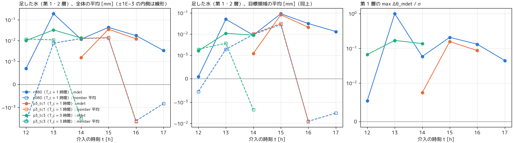

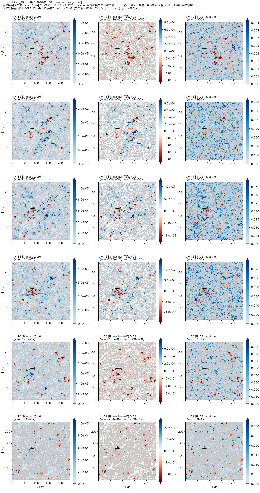

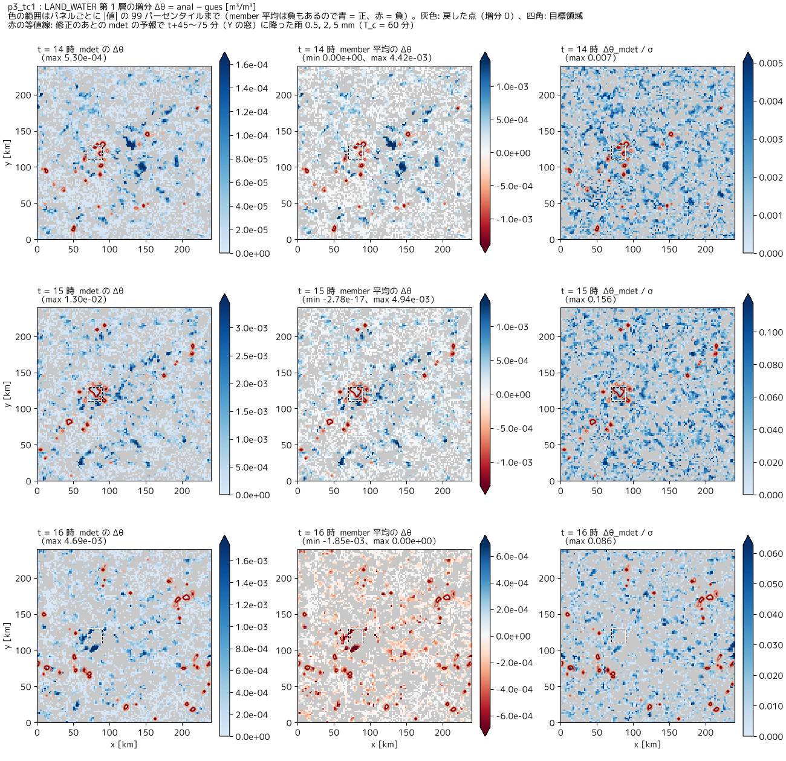

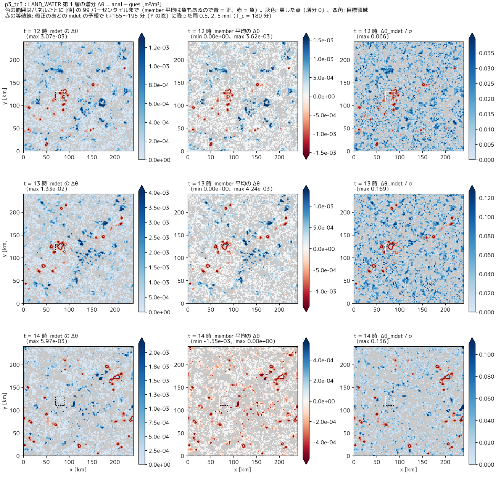

- 増えた点は領域全体に散らばる（`HORI_LOCAL = 1.0D6` で局所化がないため）。目標領域の平均が全体の平均より大きい cycle（15・16・17 時）も、小さい cycle（12・13 時）もある。戻した点はどの cycle でもほぼ半分
- 足した水は多くても全体の平均で 0.2 mm（r080 の 13 時）、目標領域の平均で 0.09 mm（r080・p3_tc1 の 15 時）。ほかは 0.01〜0.04 mm 程度
- **member 平均の増分は、cycle ごとに全点が同じ符号**（正の cycle では min = 0、負の cycle では max = 0）。負になるのは r080 の 12・16・17 時、p3_tc1 の 16 時、p3_tc3 の 14 時。
  これは式どおり: 目標は 1 個なので、どの点でも member 平均の増分 = K (y* − Ȳ)、mdet の増分 = K (y* − Y_mdet) で、ゲイン K を共有する。
  y* = 0.8 Ȳ < Ȳ なので y* − Ȳ は常に負。一方 mdet の予報が y* より少ない cycle（上の 5 つ。たとえば p3_tc1 の 16 時は Y_mdet 約 0.06 に対し y* = 0.165）では y* − Y_mdet が正になる。
  そのため、mdet を湿らせる点（K > 0 の点）で member 平均は乾く。逆に Y_mdet > y* の cycle では、mdet も member 平均も、K < 0 の点で湿る
- つまり、Y_mdet < y* の cycle では、mdet は「雨を増やす」向きに押されている（y* は member の Ȳ から決まるため）
- 3.9 の表の「第 1 層の max |Δθ|/σ」（LETKC のログ）は、向きの判定・切り詰めの前の値。13 時は 1.78 だが、制約のあとの anal − gues では 0.99（max |Δθ| 7.68E−02 は一致）

#### 読み取り（解釈は相談中）

- T_c = 3 時間（p3_tc3）だけが合計の雨を減らした（−4.7%）。ただし 1 本ずつの比較なので、3.8・3.9 と同じく、修正の効果とカオスによる揺れは分けられない
- Y_mdet < y* の cycle では、制御は mdet の雨を増やす向きに働く。目標値を member の Ȳ から決める今の設定で、mdet の予報が member 平均よりも少ない場合の扱いは要相談

### 3.11 LETKC の修正の足し方を論文の形に直した（2026-11-16）

**わかったこと**: 手元の LETKC（case_tc から同じ。`letkc/letkf_tools.f90`、SCALE-LETKF の DET_RUN の処理の流用）は、
member には平均の移動 K (y* − Ȳ) を、mdet には自分の差による K (y* − H(x_mdet))（`transmd`）を足していた。
Sawada (2024, SOLA) の Algorithm 1 Step 4（と Sawada et al. 2026, GRL）は、平均の増分を nature と全 member に同じく足す（controller は nature を知らない）。
3.9・3.10 の結果では Δθ_mdet / Δθ_mean が cycle ごとに −4〜26.5（r080 の 13 時が 26.5、負の cycle では mdet と member が逆向き）。
指導教員も「制御目標（の量）だけ mdet から知っていることになっているので直したほうがいい」と確認（2026-11-16）。
**3.9・3.10 の r080・p3_tc1・p3_tc3 は、この直す前の形の結果**（nocontrol は影響なし）。

**直したもの**（ユーザーの決定。案 B）:
- `&PARAM_LETKC_CONTROL` に `CONTROL_LEGACY_TRANSMD`（既定 `.false.`）。既定では増分 Δx = β Xᵇ w̄（w̄ = `transm`）を 1 本作り、mdet と全 member に同じく足す
  （member のばらつきは第一推定のまま。ETKF のばらつきの変換・RTPP・RTPS・`Q_SPRD_MAX` は使わない）。`.true.` は直す前の形（過去の結果の再現用。正しい形に一本化したら消す）
- 制約（向き・λ・範囲）は変えていない。範囲（0〜0.5）の切り詰めは値ごとなので、切り詰めた点だけは足した量が mdet・member で違う
- 直す前の実行ファイルは `letkc/letkc.before_sameinc_20261116`（git の管理外）

**試験**（`mpc_soil/test_same`、ジョブ 10340225、2 member・1 cycle（12 → 13 時）・debug-o、約 8 分）。
検算は `mpc_soil/test_same_check/check_same_increment.py`（出力 `check_same_increment.out`）:
- ログに `LETKC update: the same control increment Xb*transm (mean shift) is added to mdet and all members`
- LAND_WATER の第 1・2 層の anal − gues は、mdet・member 1・member 2 とも、平均の移動に制約をかけた予測と 1E−9 以内で一致
- mdet と各 member の増分の差は、切り詰めた点（第 1 層の 7 点）を除いて 6E−17 以下。ばらつき（sprd）は修正の前後で変わらない（3E−17 以下）
- 第 3〜7 層は変わらない

**本番の流し直し**（投入: `control/20261116_mpc_same/submit.sh`。20261107 版との違いは、LETKC の設定に `CONTROL_LEGACY_TRANSMD = .false.` を明示すること、
結果を `mpc_same/<実験名>/` に置くこと、`NNODES` を引数で渡せること）:

| 名前 | 設定 | ジョブ | 投入 |
| --- | --- | --- | --- |
| `mpc_same/p3_tc3` | 3.10 の p3_tc3 と同じ（TC = 10800、介入 12・13・14 時、TIME_LIMIT 03:30:00）、既定の 1,476 ノード（x-large-o） | 10340450 | 2026-11-16 18:35。開始見込み 11-18 00:00 |
| `mpc_same/p3_tc3_l05` | p3_tc3 と同じで、λ = 0.5（`LAMBDA=0.5D0`。&#124;Δx&#124;/σ が最大の 0.5 倍より小さい点は修正しない） | 10340940 | 2026-11-16 20:01。開始見込み 11-18 06:00 |

（はじめ `NNODES=1116` で large-o に入れたが（ジョブ 10340443）、開始見込みが同じ 11-18 00:00 だったので、x-large-o で投げ直した。開始は変わらなかった）

どちらも正常に終わった（p3_tc3: 11-18 01:35、p3_tc3_l05: 11-18 04:11 に完了）。

#### 結果：目標領域の雨（2026-11-18）

`analysis/control/20261116_mpc_same/plot_hyeto.py`（読み込みは `compare_mpc_soil.py` の `area_acc` を import。ログインノードで約 1 分）。
mpc_same の 2 本に、直す前の p3_tc3（`mpc_soil/p3_tc3`）と制御なし（`mpc_soil/nocontrol`）を並べた。出力は `20261116_mpc_same/plot_hyeto.out`。

| t | λ = 0: t〜t+60 分 | λ = 0.5: t〜t+60 分 | 直す前の λ = 0: t〜t+60 分 | nocontrol: t〜t+60 分 |
| --- | --- | --- | --- | --- |
| 12 | 0.016 | 0.016 | 0.016 | 0.016 |
| 13 | 0.980 | 0.978 | 0.983 | 0.989 |
| 14 | 1.260 | 1.248 | 1.269 | 1.144 |
| 15 | 5.373 | 6.418 | 6.643 | 5.568 |
| 16 | 1.178 | 3.231 | 1.710 | 3.427 |
| 17 | 0.000 | 0.015 | 0.000 | 0.001 |
| 12〜18 時の合計 | **8.81**（−21.0%） | **11.91**（+6.8%） | **10.62**（−4.7%） | **11.14** |

| 実験 | t | Ȳ / σ_Y / y*（修正前の member） | Y_mdet（修正のあとの予報） |
| --- | --- | --- | --- |
| λ = 0 | 12・13・14 | 1.439 / 0.802 / 1.151、2.831 / 1.716 / 2.265、0.139 / 0.232 / 0.111 | 1.299、2.602、0.003 |
| λ = 0.5 | 12・13・14 | 1.439 / 0.802 / 1.151、2.684 / 1.533 / 2.147、0.128 / 0.332 / 0.102 | 1.330、3.814、0.144 |
| 直す前の λ = 0 | 12・13・14 | 1.439 / 0.802 / 1.151、2.763 / 1.676 / 2.211、0.097 / 0.179 / 0.077 | 1.417、3.423、0.003 |

Y の窓は t+165〜195 分。単位は mm。直す前の λ = 0 の値は 3.10 と一致する。

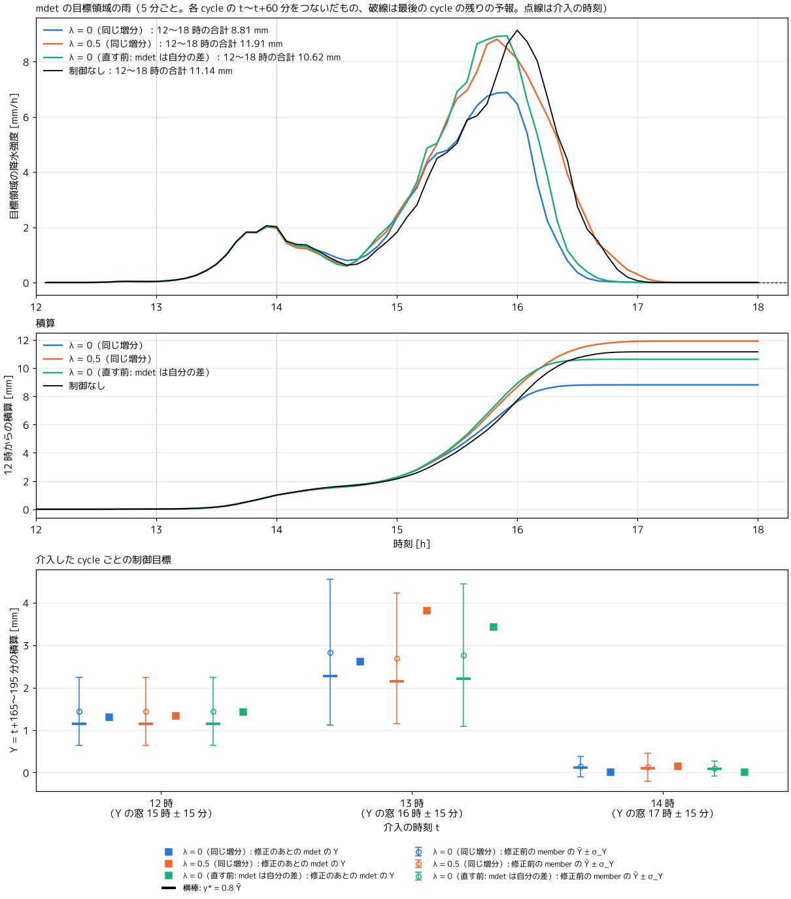

- 15 時までは 4 本ともほぼ同じ。差は 15:30〜16:30 のピークで出る。λ = 0 はピークが約 6.9 mm/h（nocontrol は 9.1 mm/h）で、早く終わる
- 13 時の介入では、λ = 0.5 と直す前の λ = 0 の Y_mdet が y* を大きく上回った（3.81・3.42。y* は 2.15・2.21）。λ = 0 は 2.60（y* 2.26）

#### 結果：どこでどれだけ土壌水分を増やしたか（2026-11-18）

`analysis/control/20261116_mpc_same/plot_increment.py`（読み込み・集計は 20261107 版の `plot_increment.py` を import）。読み込みは 2 実験で約 12 分（ログインノード）。
読んだ値は `mpc_same/increment_cache/increment_<実験名>.npz`。地図は、行 = 介入した cycle、列 = λ = 0 と λ = 0.5 のそれぞれ [Δθ、Δθ / σ]（第 1 層、mdet）で、
色の範囲は行ごと・量ごとに 2 実験で共通。量の図には直す前の p3_tc3 も足した。出力は `20261116_mpc_same/plot_increment.out`。

| 実験 | t | 足した水 mdet: 全体 / 目標領域 [mm] | 第 1 層の max Δθ | max Δθ / σ | 増えた点 / 増分 0 の点 |
| --- | --- | --- | --- | --- | --- |
| λ = 0 | 12 | 0.0118 / 0.0019 | 3.7E−03 | 0.079 | 7,397 / 7,003 |
| λ = 0 | 13 | 0.0106 / 0.0041 | 2.9E−03 | 0.063 | 7,231 / 7,169 |
| λ = 0 | 14 | 0.0046 / 0.0012 | 1.2E−03 | 0.022 | 8,285 / 6,115 |
| λ = 0.5 | 12 | 0.0012 / 0.0003 | 3.7E−03 | 0.079 | 243 / 14,157 |
| λ = 0.5 | 13 | 0.0010 / 0.0004 | 4.8E−03 | 0.072 | 213 / 14,187 |
| λ = 0.5 | 14 | 0 / 0 | 0 | 0 | 0 / 14,400 |
| 直す前の λ = 0 | 12 | 0.0099 / 0.0016 | 3.1E−03 | 0.066 | 7,397 / 7,003 |
| 直す前の λ = 0 | 13 | 0.0323 / 0.0108 | 1.3E−02 | 0.169 | 7,250 / 7,150 |
| 直す前の λ = 0 | 14 | 0.0133 / 0.0088 | 6.0E−03 | 0.136 | 6,041 / 8,359 |

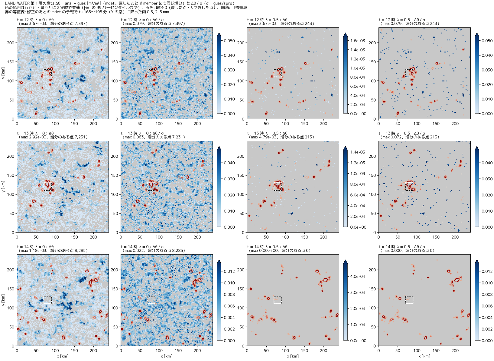

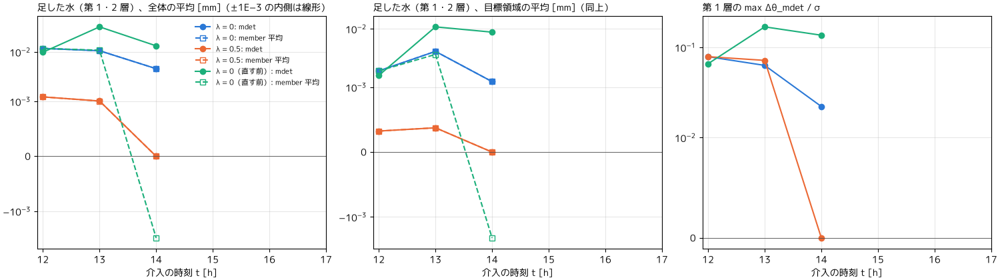

- 同じ増分になっているか: mdet と member 平均の増分の差は、範囲で切り詰めた点（λ = 0 で 1 cycle 142〜172 点、λ = 0.5 で 0〜7 点）を除いて 4E−16 以下。
  そのため量の図では mdet と member 平均の線が重なる（直す前は 14 時に逆向き）
- λ = 0 の増えた点は、直す前と同じく領域全体に散らばる。足した水は全体の平均で 0.005〜0.012 mm、max Δθ / σ は 0.08 以下
- λ = 0.5 は増分のある点が 200 点ほど（全体の 2% 未満）で、足した水は λ = 0 の約 1/10。14 時は目標を読んでいる（obsdepcont が空でない）のに増分のある点が 0。
  理由は未確認（閾値を超えた点がみな乾かす向きで戻された可能性）
- 量の図の横軸が 17 時まであるのは 20261107 版の関数をそのまま使ったため（データは 12〜14 時だけ）

#### 読み取り（解釈は相談中）

- 足した水は全体の平均で 0.01 mm 程度以下（λ = 0.5 は 0.001 mm 程度）なのに、合計の雨は −21%〜+6.8% 変わった。特に λ = 0.5 はほとんど水を足していない。
  1 本ずつの比較なので、修正の効果とカオスによる揺れは分けられない（3.8〜3.10 と同じ）
---

## 関連する文書

- 修正量の式と、ばらつき・相関の関係の解説: `docs/control/tex/enkc_variance.tex`（PDF も同じ場所）
- 今週のまとめ（制御実験の条件と結果）: `docs/control/tex/20261104_summary.tex`
