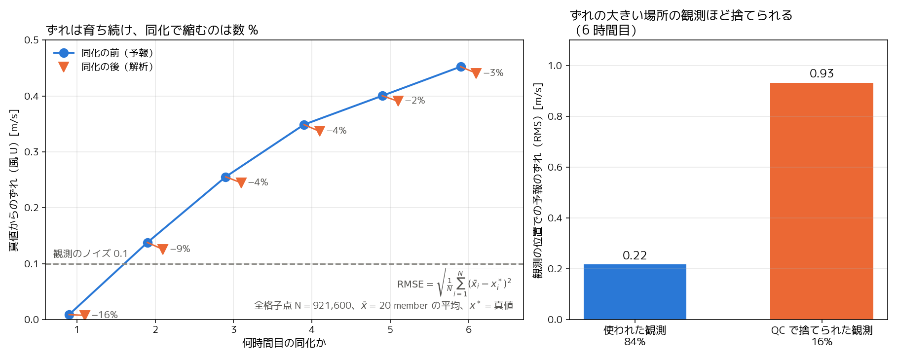

# 2026-10-07 ミーティング用メモ

1. **観測の生成**は問題なし（観測 − 真値の標準偏差 0.100 = 設定したノイズ）。真値はアンサンブルの中にいる（誤差 ÷ ばらつき ≈ 1）。
2. **データ同化**は正しく動いている（LETKF の O−B を自分の計算で再現）。ただし効果は誤差が育った 2 時間目の 9% が最大で、その後は 2〜4% しか縮まない
   （1 時間目の −16% は、ずれ自体が観測ノイズの 1/10 と小さいので参考値）。
3. **相談したいこと**: (a) QC（|観測 − 予報| > 0.5 を捨てる）が、ずれの大きい場所の正しい観測を捨てている（6 時間目に 16%）。双子実験なので緩めるか外すか。
   (b) ずれの元の土壌水分を同化で直していない。状態変数に加えるか（計画書 Phase 7d「決めること 4」）。

**「ずれ」の定義**: 全格子点の RMSE。RMSE = √( (1/N) Σ_i ( x̄_i − x*_i )² )。
x̄_i は格子点 i のアンサンブル平均（20 member、同化の前 = 予報・後 = 解析）、x*_i は真値（mdet）、N = 120 × 120 × 64 = 921,600。
「同化で何 % 縮んだか」は 1 − RMSE(解析) / RMSE(予報)。右の図は、観測の位置での予報のずれ（H(アンサンブル平均) − H(真値)）の RMS。

図: `analysis/plot_summary.py`（ジョブ 9844986、制御なしの 6 cycle、1/31 00 時開始、土壌水分の摂動）。詳細は `../phase7d_notes.md`。
