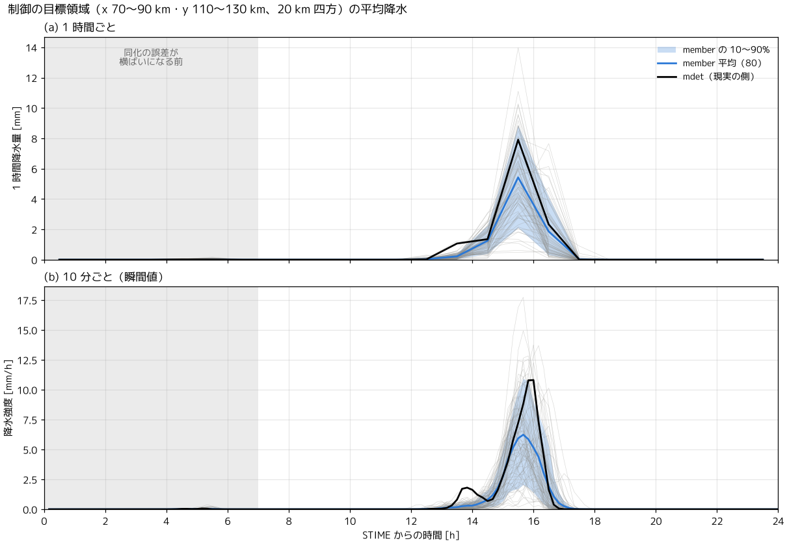

# Phase 9 — 対流性降雨の制御の設計と実装（記録）

方針・決定事項は計画書（`docs/20260923_experiment_plan.md`）の Phase 9-1。ここには実行と結果を残す。

## 2026-11-02 制御の目標領域の降水の時間変化

介入の時刻を、雨の時刻から逆算して決めるための材料。制御の効果を EnKC で測るには、次の 3 つが要る（ユーザー）:
同化の誤差が横ばいになった後であること、mdet（現実の側）で目標領域に雨があること、土壌水分が雨に効くまでの時間をとれること。

### 方法

- 目標領域: x = 80 km・y = 120 km を中心とする 20 km 四方（x 70〜90 km・y 110〜130 km、格子番号 i 35〜44・j 55〜64、0 始まり。10 × 10 格子）。
  4 プロセス分のファイル（`history.pe000063`・`64`・`75`・`76`）にまたがる
- データ: Phase 8 の 24 時間（80 member、`result_m80`、ジョブ 10083341、制御なし）。各 cycle の 1 時間予報の history の地上降水強度 `PREC`（10 分ごと）を目標領域で平均した
  - 1 時間降水量は 600〜3600 s の 6 時刻 × 600 s の和（`plot_member_prec.py` と同じ近似）。定式化の格子の和 Σ P は、この平均 × 100
  - 目標領域だけを読む方法が、全格子を読んで切り出した値と一致することを、mdet の 0・1・12 時の cycle で確認した
- スクリプト: `analysis/plot/plot_target_prec.py`（ジョブ `analysis/plot/plot_target_prec_job.sh`、Aquarius、ジョブ 10118605、約 3 分）
- 出力: `target_prec/target_prec.png`・`target_prec.out`（表）・`target_prec.npz`（10 分ごとの値）

### 結果

| 時間 [h] | mdet [mm] | member 平均 | 10% | 50% | 90% | 最大 | mdet の順位（多い順 / 80） |
| --- | --- | --- | --- | --- | --- | --- | --- |
| 12–13 | 0.02 | 0.04 | 0.00 | 0.02 | 0.09 | 0.30 | 35 |
| 13–14 | 1.07 | 0.22 | 0.04 | 0.18 | 0.43 | 1.23 | 2 |
| 14–15 | 1.35 | 1.25 | 0.41 | 1.15 | 2.25 | 3.08 | 30 |
| 15–16 | **7.90** | 5.42 | 2.11 | 5.26 | 8.84 | 13.97 | 17 |
| 16–17 | 2.32 | 1.86 | 0.32 | 1.35 | 4.10 | 7.65 | 24 |
| 17–18 | 0.00 | 0.03 | 0.00 | 0.00 | 0.05 | 0.90 | 69 |

上の 6 時間以外は、どの member もほぼ 0（4〜6 時に 0.02 mm 程度の弱い雨があるだけ）。
24 時間の合計は mdet 12.70 mm、member 平均 8.85 mm（最小 1.80・最大 19.00 mm）。Phase 8 の 12〜24 時間の積算の値（mdet 12.7・平均 8.8 mm）と合う。

- 目標領域の雨は、**13〜17 時の 1 回のイベント**。ピークは 15〜16 時。
- **イベントの時刻は、ほぼすべての member でそろっている**。member で違うのは強さ（15〜16 時の 1 時間降水量で 10〜90% が 2.1〜8.8 mm）。
- **mdet は強い側**: 15〜16 時は 7.90 mm で、80 member 中 17 位。10 分ごとのピークは約 11 mm/h（15.8 時ごろ）。13〜14 時には、member にはほとんどない早い雨（1.07 mm、2 位）がある。
- 3 つの条件との関係:
  - 雨は同化の誤差が横ばいになる 7 時より後にある
  - mdet に抑える対象の雨がある
  - 降り始め（12.5〜13 時）まで、7 時から 5〜6 時間の余裕がある

### 介入の時刻を決めるための材料（まだ決めていない）

- 目標の候補: 15〜16 時の 1 時間降水量（ピーク）、または 13〜17 時の合計
- 介入の時刻は、7 時（同化の誤差が横ばい）から 12 時（降り始めの直前）の間。土壌水分が雨に効くまでの時間をどれだけとるかで決まる。
  対流の発生・発達の気象学的な知見も踏まえて決める（計画書 Phase 9-1）
