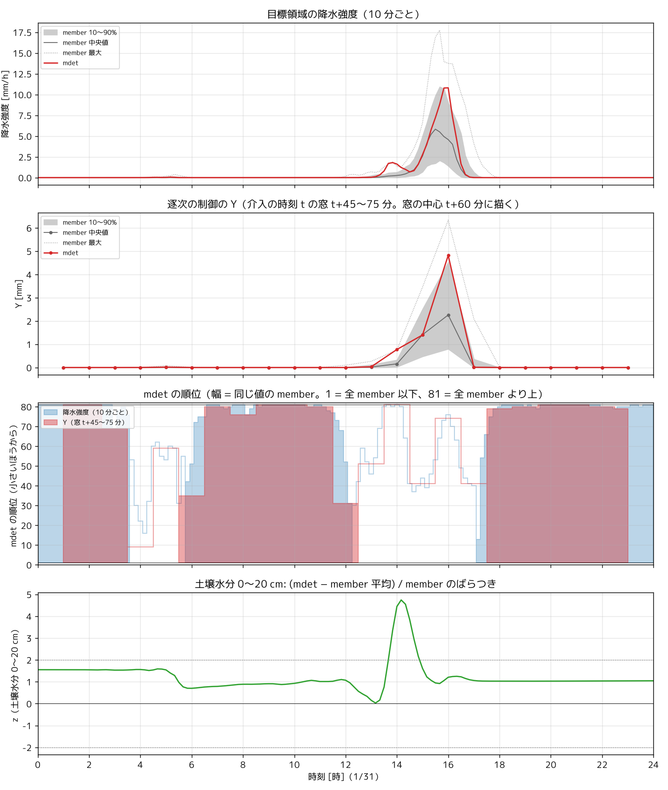

# Phase 8 の追加検証：真値（mdet）は 80 member の中で何番目にいるか（2026-11-07）

**目的**: 逐次の制御（docs/control/notes.md 1.3）では、mdet の修正量が「目標 − mdet 自身の予報」で決まる（LETKC の作り）。
mdet がアンサンブルの分布の外にいると、修正の向き・大きさが想定とずれうる。
これまで確かめていたのは時間帯の一部（13〜17 時の合計・13〜14 時・15〜16 時）だけだったので、0〜24 時を通して確かめた。
あわせて、notes.md 1.4 の「土壌水分のアンサンブル平均と mdet の差が、ばらつきと同じくらいか」も見た。

## 方法

- データ: result_m80（24 時間の cycle、80 member + mdet、ジョブ 10083341）の各 cycle の 1 時間予報の history を、目標領域
  （x 70〜90 km・y 110〜130 km）で平均して 10 分ごとにつないだもの（`docs/control/20261102_soil_track/soil_track.npz`。新しく history は読んでいない）
- 見た量
  - 降水強度（10 分ごとの瞬間値）
  - 逐次の制御の Y の近似: 介入の時刻 t の窓 (t + 45, t + 75] 分の積算。10 分ごとの瞬間値なので、t + 50・60・70 分の 3 時刻 × 600 s の和
  - 土壌水分 0〜20 cm（第 1・2 層の厚さの重み平均）。z = (mdet − member 平均) / member の標準偏差
- 順位は小さいほうから。雨が 0 の member が多いと同じ値が並ぶので、「mdet より小さい数 + 1」〜「mdet 以下の数 + 1」の幅で表す（1〜81 の全幅なら、全員 0 で順位は決まらない）
- スクリプト: `analysis/setup/phase8/check_mdet_rank.py`（ログインノード、約 10 秒）
- 出力: `mdet_rank/mdet_rank.out`・`mdet_rank/mdet_rank.png`

## 結果

### 逐次の制御の Y（窓 t + 45〜75 分）

| 介入の時刻 t | mdet [mm] | member 平均 | member 10〜90% | 最大 | mdet の順位 |
| --- | --- | --- | --- | --- | --- |
| 11 時 | 0.000 | 0.002 | 0.000〜0.004 | 0.101 | 1〜31（mdet は 0、member の 50 本に少し雨） |
| 12 時 | 0.032 | 0.044 | 0.001〜0.121 | 0.267 | 51 |
| **13 時** | **0.775** | 0.170 | 0.031〜0.330 | 0.755 | **81（全 member より上、分布の外）** |
| 14 時 | 1.400 | 1.450 | 0.476〜2.519 | 3.459 | 41 |
| 15 時 | 4.820 | 2.564 | 0.799〜4.530 | 6.332 | 74 |
| 16 時 | 0.012 | 0.147 | 0.000〜0.361 | 2.093 | 41 |
| 17 時 | 0.000 | 0.000 | 0.000〜0.000 | 0.019 | 1〜79（ほぼ全員 0） |

- 雨のある時間帯で mdet が分布の外にいるのは、**13 時の窓（13:45〜14:15）だけ**。mdet の早い雨（13:30〜14:00 ごろの小さな山）が、どの member にもない
- 15 時の窓では上位（74 番目）だが中にいる。12・14・16 時は真ん中あたり
- 10 分ごとの降水強度でも、雨のある 83 時刻のうち分布の外は 2 時刻（どちらも最大より上）だけ
- 0〜10 時・17 時以降は、ほぼ全員 0 で、順位は決まらない（Y が 0 なので、σ_Y = 0 で修正もかからない）

### 土壌水分 0〜20 cm

- mdet は 0〜24 時を通して**アンサンブル平均より湿った側**にいる（z = +0.7〜+1.6、順位 68〜78 番目）。分布の中ではあるが、ずっと同じ側
- ばらつきは、雨の前は **0.0001〜0.0002**（notes.md の「約 0.001」より 1 桁小さい。0.001 は領域全体の格子ごとの値、こちらは 20 km 平均）。
  mdet と平均の差も同じくらい（0.0002 前後）なので、ばらつきは「実際の誤差」と同じ大きさで、過小評価にはなっていない（notes.md 1.4 の確認）
- 14 時に z = +4.4（分布の外）: mdet の早い雨で mdet の土壌だけが先に湿ったため。雨のあとはばらつきが 0.01 前後に増え、z は +1 に戻る

## わかったこと

- 逐次の制御の介入の時刻のうち、**13 時（窓 13:45〜14:15）では mdet が分布の外**にいる。このとき mdet の修正量（y* − H(x_mdet)、y* = 0.8 Ȳ）は、
  目標と mdet の差が member の幅よりずっと大きくなる（Ȳ = 0.17 mm に対して mdet 0.78 mm、y* = 0.14 mm）。試験では、この cycle の修正量に注意する
- それ以外の雨のある時刻（12・14・15・16 時）は、mdet は分布の中にいる
- 土壌水分のばらつき（20 km 平均で 0.0001〜0.0002）は、mdet と平均の差と同じくらいで、この双子実験の中では不確かさを正しく表している。
  そのぶん、土壌水分を通した感度（cov）は小さい
